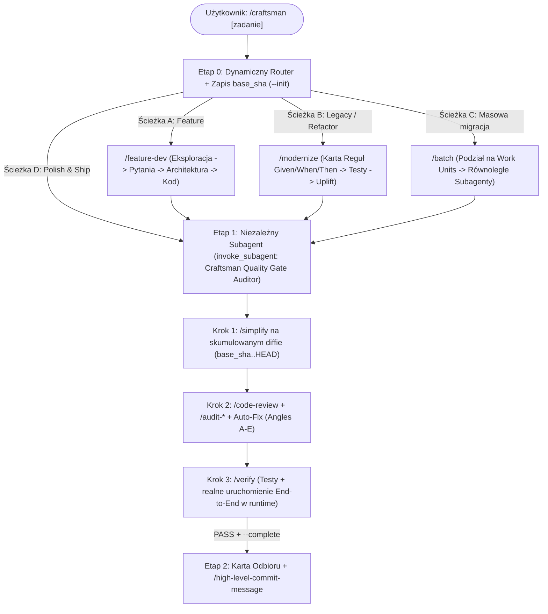

# 🛠️ Craftsman — Master Software Engineering Suite for Antigravity

Kompletny zestaw inżynierskich skilli, audytorów, orkiestratora `/craftsman` oraz globalnych reguł (`ultrathink` / `ultracode` + higiena Git) dla środowiska **Google Antigravity**. Zaprojektowany jako inżynieryjny odpowiednik naukowego orkiestratora `/k-dance`, łączący najlepsze praktyki z wbudowanych narzędzi i oficjalnych pluginów Claude Code v2.1.287 oraz autorskich skilli optymalizacyjnych.

---

## 🚀 Szybka instalacja na nowej maszynie

```bash
git clone https://github.com/BuczynskiRafal/craftsman.git ~/.gemini/craftsman
cd ~/.gemini/craftsman
./install.sh --symlink
```

### Tryby instalacji (`./install.sh`):
- `./install.sh --copy` *(domyślny)* — kopiuje skille, reguły, `hooks.json` oraz skrypty do `~/.gemini/config/`.
- `./install.sh --symlink` *(zalecany)* — tworzy dowiązania symboliczne do sklonowanego repozytorium, dzięki czemu zwykłe `git pull` od razu aktualizuje wszystkie skille, reguły i hooki.
- `./install.sh --plugin` — instaluje cały pakiet jako przełączalny plugin Antigravity w `~/.gemini/config/plugins/craftsman` (zarządzany przez `/plugin`).
- `./install.sh --copilot` — eksportuje wszystkie 20 skilli jako pliki `*.prompt.md` oraz globalne reguły jako `craftsman-rules.instructions.md` do profilu użytkownika VS Code (`Code/User/prompts`), udostępniając komendy `/craftsman`, `/simplify`, `/code-review`, `/verify` itd. w **GitHub Copilot Chat**.
- `./install.sh --copilot-workspace <ścieżka>` — eksportuje `.github/prompts/*.prompt.md` oraz `.github/copilot-instructions.md` bezpośrednio do wskazanego repozytorium projektu.
- `./install.sh --git-hooks` — instaluje globalne hooki `/usr/bin/git` (`commit-msg` oraz `pre-push`) w `~/.gemini/config/git-hooks` i ustawia `git config --global core.hooksPath` (z automatycznym łańcuchowaniem lokalnych hooków `.git/hooks/*` w repozytoriach), co wymusza twardą ochronę Gita również w **GitHub Copilot**, **Cursorze** i zwykłym terminalu.
- Flagi można łączyć, np.: `./install.sh --symlink --copilot --git-hooks`.

---

## 🧭 Architektura Orkiestratora `/craftsman`



---

## 📦 Zawartość pakietu (20 Skilli + 2 Reguły Globalne)

### 1. Główny Orkiestrator
| Komenda | Opis |
| :--- | :--- |
| **`/craftsman`** | Główny dyrygent inżynierski end-to-end. Śledzi skumulowany diff od początku zadania (`base_sha..HEAD`), dobiera workflow architektoniczny (A–D) i wymusza (weryfikowaną w `transcript.jsonl`) Bramkę Jakości wykonywaną przez niezależnego subagenta (`Craftsman Quality Gate Auditor`: `/simplify` -> `/code-review` -> `/audit` -> `/verify`). |

### 2. Workflowy Architektoniczne i Transformacyjne
| Komenda | Opis |
| :--- | :--- |
| **`/feature-dev`** | 7-fazowa budowa nowej funkcjonalności: eksploracja kodu -> pytania doprecyzowujące -> 2–3 warianty architektury -> implementacja -> review. |
| **`/modernize`** | Bezpieczna modernizacja zastanego kodu: ekstrakcja reguł biznesowych do tablicy `Given / When / Then`, testy zabezpieczające (*characterization tests*), refaktor i dowód równoważności. |
| **`/batch`** | Masowe, równoległe migracje i refaktoryzacje (5–30 niezależnych jednostek pracy wykonywanych przez subagenty w tle). |

### 3. Codzienna Bramka Jakości (Core Quality Gate)
| Komenda | Opis |
| :--- | :--- |
| **`/simplify`** | Oczyszczanie świeżo napisanego kodu bez zmiany zachowania (Reuse, Simplification, Efficiency, Altitude + zasady `code-simplifier`). |
| **`/code-review`** | 10-kątowy przegląd kodu (lokalny diff, gałąź lub PR z GitHuba/GitLaba) z adaptacyjnym trybem inline/subagent oraz weryfikacją znalezisk (`CONFIRMED` / `PLAUSIBLE` / `REFUTED`). |
| **`/verify`** | Weryfikacja zmian end-to-end w prawdziwym środowisku uruchomieniowym (CLI, serwer HTTP, pipeline danych, headless FreeCAD/QGIS) zamiast polegania wyłącznie na suchych testach jednostkowych. |
| **`/high-level-commit-message`** | Generowanie zwięzłych, wysokopoziomowych komunikatów commitów w standardzie Conventional Commits (American English). |

### 4. Specjalistyczne Audyty Głębokie (`/audit`)
| Komenda | Opis |
| :--- | :--- |
| **`/audit`** | Orkiestrator audytów uruchamiający wybrane lub wszystkie poniższe audyty równolegle (`/audit all`, `/audit errors,security`). |
| **`/audit-errors`** | *Silent Failure Hunter* — polowanie na połknięte wyjątki, zbyt szerokie `try/except` i ciche fallbacki zwracające `None`/`0`/`[]`. |
| **`/audit-tests`** | *Behavioral Test Coverage* — ocena pokrycia behawioralnego, warunków brzegowych i odporności testów na refaktoryzację (skala 1–10). |
| **`/audit-types`** | *Type & Invariant Analyzer* — ocena modeli danych, dataclass i Pydantic na 4 osiach (*make illegal states unrepresentable*). |
| **`/audit-comments`** | *Comment Rot Analyzer* — krzyżowa weryfikacja docstringów i komentarzy względem faktycznej implementacji. |
| **`/audit-security`** | *Source-to-Sink Taint Auditor* — analiza bezpieczeństwa przepływu danych z oceną CWE i minimalnymi łatkami. |

### 5. Wydajność, Czystość Kodu i Narzędzia Domenowe
| Komenda | Opis |
| :--- | :--- |
| **`/code-quality`** | Analiza czystości architektury pod kątem DRY, SOLID, ortogonalności i spójności. |
| **`/extreme-optimizer`** | Iteracyjna, oparta na profilowaniu optymalizacja wydajności z wymogiem benchmarku i dowodu izomorfizmu wyników. |
| **`/leetcode-style-code-reviewer`** | Bezlitosny przegląd wydajnościowy kodu Python/NumPy/PyTorch w stylu finalisty ICPC. |
| **`/humanizer`** | Usuwanie śladów sztucznego stylu AI z dokumentacji, tekstów i opisów. |
| **`/build-freecad`** | Budowanie paczki dystrybucyjnej `.zip` dla workbenchu FreeCAD (`trasownik`). |
| **`/deploy-freecad-local`** | Lokalny deployment paczki `.zip` do katalogu `Mod` FreeCADa w celu testów manualnych. |

---

## ⚡ Globalne Reguły (`rules/`) i Hybrydowy Hard-Loop (`hooks.json` + `scripts/`)

### Reguły kontekstowe (`rules/`)
1. **`ultra_mode.md`** — Słowa-klucze wyzwalające rygor inżynierski w dowolnym prompcie:
   - **`ultrathink`** — wymusza sekcję *Deep Reasoning & Architecture Analysis* (założenia, warunki brzegowe, złożoność Czas/Pamięć, porównanie min. 2 podejść) przed napisaniem pierwszej linijki kodu.
   - **`ultracode`** — wymusza pełny rygor wykonawczy w trybie Hard-Loop z niezależnym subagentem audytującym (`Twórca ≠ Recenzent`): `--init` -> równoległe subagenty `research` -> Implementacja -> niezależny subagent `Craftsman Quality Gate Auditor` (`/simplify` -> `/code-review` -> `/verify` na skumulowanym diffie) -> `--complete`.
2. **`git_workflow.md`** — Ochrona gałęzi `main`/`master` przed niepotwierdzonym `git push`, ścisła tożsamość autora (`Rafał Buczyński`), zero atrybucji AI w commitach oraz atomowe commity Conventional Commits.

### Deterministyczne Strażniki Systemowe (`hooks.json` + `scripts/`)
Pakiet wykorzystuje natywne **Lifecycle Hooks** Antigravity do fizycznego egzekwowania kluczowych niezmienników poza modelem:
1. **`craftsman-git-guard` (`PreToolUse` -> `scripts/git-guard.py`):**
   - **Zero AI Attribution (Global Rule #2):** Przechwytuje wywołania `git commit`, `git tag`, `git merge` oraz `gh pr create` zawierające `Co-authored-by:` lub stopki `Generated by/with ...` i blokuje je na poziomie procesu (`"decision": "deny"`).
   - **Ochrona `main`/`master` (Global Rule #1):** Przechwytuje `git push` celujący w `main` lub `master`, sprawdza w `transcript.jsonl`, czy po ostatnim pushu wywołano `ask_question` z pytaniem do użytkownika, i blokuje nieautoryzowane wypchnięcie (`"decision": "deny"`, lub `"force_ask"` przy `--force`).
2. **`craftsman-stop-gate` (`Stop` -> `scripts/craftsman-stop-gate.py`):**
   - Podczas sesji `/craftsman` lub `ultracode` (również wykrywanych automatycznie z `transcript.jsonl`, nawet jeśli agent zapomniał wywołać `--init`) śledzi początkowy commit `base_sha` (cały skumulowany diff `base_sha..HEAD`).
   - **Zero-Trust Subagent Verification (`Twórca ≠ Recenzent`):** Nie ufa deklaracjom głównego agenta na słowo — skanuje systemowy log `transcript.jsonl` i fizycznie blokuje zamknięcie bramki (`--complete` oraz `Stop` -> `{"decision": "continue"}`), dopóki główny agent nie powoła niezależnego subagenta przez `invoke_subagent` (`Role: "Craftsman Quality Gate Auditor"`), który ze świeżym kontekstem wykona `/simplify`, `/code-review`, `/audit` oraz `/verify` na całym skumulowanym diffie.
   - Przy zwykłych rozmowach (bez `/craftsman` i bez `ultracode`) działa w trybie przezroczystym bez narzutu.
