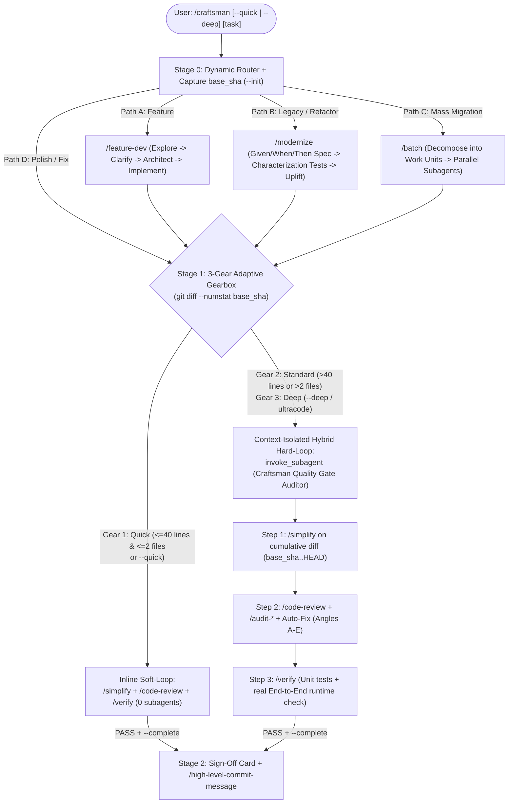

# Craftsman — Adaptive Closed-Loop Engineering Harness

[](https://github.com/BuczynskiRafal/craftsman/actions/workflows/ci.yml)
[](pyproject.toml)
[](pyproject.toml)
[](pyproject.toml)
[-brightgreen.svg)](pyproject.toml)
[](plugin.json)
[](LICENSE)
[](#multi-platform-installation)

**Craftsman** is a zero-dependency, cross-platform, invocation-steerable **agentic engineering loop and verification harness** for **Claude Code**, **OpenAI Codex CLI**, **GitHub Copilot**, **Cursor**, **Windsurf**, and **Google Antigravity**.

It unifies a curated set of **17 high-signal open-ecosystem engineering skills** with a deterministic **Hybrid Hard-Loop state machine**—enabling AI coding agents to autonomously prepare, implement, review, and runtime-verify software changes while scaling verification depth to match the complexity of the diff.

---

## Problem Statement & Architectural Gap

In long-horizon software engineering, reliability is bounded less by raw model weights and more by the **enclosing runtime harness**—the control loop governing context isolation, tool execution, verification feedback, and termination criteria. Current AI coding workflows exhibit three structural limitations:

1. **Open-Loop Termination in Default Harnesses:**
   Out of the box, most coding harnesses operate as single-trajectory open loops: once the model produces code that compiles or passes a shallow check, it terminates its turn. Transitioning from code synthesis to structural cleanup (`/simplify`), defect analysis (`/code-review`), and runtime verification (`/verify`) requires the engineer to manually chain prompts after every change.
2. **The Prompt-Library vs. Heavy-Swarm Trade-Off:**
   Open-source skill collections provide reusable prompt instructions (`SKILL.md`), but offer no runtime enforcement when an agent skips verification steps. Conversely, rigid multi-agent frameworks force expensive subagent handoffs even on 5-line configuration edits, wasting test-time compute and latency.
3. **In-Context Trajectory Conditioning:**
   When an agent evaluates a complex, multi-file refactor inside the same context window where it just spent dozens of tool calls debugging and authoring that code, its review is conditioned on its own prior reasoning trajectory rather than an unconditioned inspection of the resulting diff.

### Landscape Comparison

| Dimension | Default Agent Harnesses *(Claude Code, Codex, Copilot, Cursor)* | Static Skill / Prompt Collections | Rigid Multi-Agent Frameworks | **Craftsman (Hybrid Closed-Loop Harness)** |
| :--- | :--- | :--- | :--- | :--- |
| **Execution Topology** | Open-loop (stops after initial implementation) | Passive prompts (manual human chaining) | Fixed multi-agent pipeline | **Autonomous closed-loop state machine (`Stage 0 -> Stage 1 -> Stage 2`)** |
| **Test-Time Compute Scaling** | Uncalibrated | Manual | High fixed overhead on all tasks | **Invocation-steerable & diff-adaptive (`Quick` / `Standard` / `Deep`)** |
| **Verification Enforcement** | Ad-hoc / inline | Soft instructions (no runtime check) | Always multi-agent | **Hybrid Hard-Loop (`Stop` hook + transcript-verified auditor subagent)** |
| **Repository & Git Hygiene** | Unconstrained | Prompt-only guidelines | Tool-specific | **Deterministic OS-level `PreToolUse`, `commit-msg`, and `pre-push` guards** |

---

## Core Architecture: How Craftsman Works

Craftsman addresses this gap through three complementary mechanisms:

### 1. Invocation-Steerable & Diff-Adaptive Loop (3-Gear Gearbox)
Verification depth can be steered explicitly at invocation time (`/craftsman --quick`, `/craftsman`, `/craftsman --deep` / `ultracode`) or delegated to empirical diff telemetry (`git diff --numstat <base_sha>` plus untracked files):
- **Gear 1 — `Quick` (Inline Soft-Loop):** For localized edits ($\le 40$ changed lines across $\le 2$ files) or `/craftsman --quick`, the agent executes `/simplify`, quick `/code-review`, and `/verify` directly in the active thread with **zero subagent overhead**.
- **Gear 2 — `Standard` (Hybrid Hard-Loop):** When the cumulative diff exceeds $> 40$ lines or $> 2$ files, the harness enforces **context-isolated verification**—spawning an isolated `Craftsman Quality Gate Auditor` subagent verified in `transcript.jsonl` to inspect and test the full cumulative diff (`base_sha..HEAD`).
- **Gear 3 — `Deep` (Full-Audit Hard-Loop):** Triggered via `/craftsman --deep` or `ultracode` for critical modules—combining pre-implementation counterfactual architecture analysis (`ultrathink`) with an isolated auditor subagent running all 5 specialized `/audit-*` suites.

### 2. Autonomous End-to-End Preparation & Review
Rather than treating implementation and review as separate manual commands, `/craftsman` governs the full engineering lifecycle autonomously:
- **Stage 0 (Preparation & Synthesis):** Captures the baseline commit (`base_sha`), profiles the working tree, and routes the task through structured architecture and implementation tracks (`/feature-dev`, `/modernize`, `/batch`).
- **Stage 1 (Closed-Loop Verification & Auto-Remediation):** Automatically runs behavior-preserving simplification (`/simplify`), 10-angle defect and security auditing (`/code-review`, `/audit-*`) with direct code fixes, and live end-to-end runtime verification (`/verify`).
- **Stage 2 (Sign-Off & Atomic Commit Proposal):** Closes the state machine (`craftsman_state.json`) and generates a concise Conventional Commit summary (`/high-level-commit-message`).

### 3. Curated Open-Ecosystem Skills + Deterministic Harness Guardrails
Craftsman aggregates and normalizes 17 high-leverage software engineering workflows—inspired by proven open-source agentic patterns for specification-driven modernization, multi-angle code review, source-to-sink taint auditing, and profile-driven optimization—and pairs them with **deterministic OS and lifecycle hooks** (`scripts/craftsman-stop-gate.py` and `scripts/git-guard.py`) that stock agent harnesses lack out of the box.



### Gearbox Comparison Table

| Gear | Trigger | Subagent Isolation? | Verification Scope | Target Workload |
| :--- | :--- | :---: | :--- | :--- |
| **Gear 1: `Quick` (Soft-Loop)** | Automatic when cumulative diff is **$\le 40$ lines across $\le 2$ files**, or manual `/craftsman --quick` | No (Fast Inline) | `/simplify` -> quick `/code-review` -> `/verify` in active thread | Config tweaks, localized bugfixes, 1–2 file adjustments |
| **Gear 2: `Standard` (Hybrid Hard-Loop)** | Automatic when cumulative diff is **$> 40$ lines or $> 2$ files**, or manual `/craftsman --standard` | Yes (`Craftsman Quality Gate Auditor`) | Isolated subagent runs `/simplify` -> `/code-review` -> `/verify` on `base_sha..HEAD` | Multi-file features, structural refactors, bugfix PRs |
| **Gear 3: `Deep` (Full-Audit Hard-Loop)** | Manual `/craftsman --deep` or keyword `ultracode` | Yes (`Craftsman Quality Gate Auditor`) | `ultrathink` pre-analysis + isolated subagent runs `/simplify` -> `/code-review` -> `/audit all` -> `/verify` | Core domain logic, security-critical modules, complex migrations |

---

## Multi-Platform Installation

One repository exports native slash commands, prompts, instructions, and lifecycle hooks across all major AI coding harnesses.

### Option A: Shell Installer (Zero Setup)

```bash
git clone https://github.com/BuczynskiRafal/craftsman.git ~/.craftsman
cd ~/.craftsman

# Install everywhere at once (Antigravity + Claude Code + GitHub Copilot + Global Git Hooks):
./install.sh --all
```

### Option B: Python CLI (`craftsman`)

Craftsman is a standard PEP 621 Python package (`python >= 3.10`) using exclusively the Python standard library:

```bash
pip install -e .

# Verify installation health, skill manifests, and active Git hooks:
craftsman doctor
craftsman doctor --json

# Inspect current repository cumulative diff and recommended Quality Gate Gear:
craftsman status --cwd /path/to/repo

# Export skills and rules to Claude Code, GitHub Copilot, Codex (AGENTS.md), and Cursor:
craftsman export --workspace /path/to/repo --agents-workspace /path/to/repo
```

### Target-Specific Flags (`./install.sh`)
| Flag | Target Platform / Effect |
| :--- | :--- |
| `./install.sh --all` | Installs across **Google Antigravity**, **Claude Code**, **GitHub Copilot**, and **Global Git Hooks** in one shot. |
| `./install.sh --claude` | Exports all 17 slash commands (`~/.claude/commands/*.md`) and global rules (`~/.claude/rules/craftsman-rules.md`) for **Claude Code**. |
| `./install.sh --copilot` | Exports all 17 prompt files (`*.prompt.md`) and global instructions (`craftsman-rules.instructions.md`) to VS Code User profile for **GitHub Copilot Chat**. |
| `./install.sh --copilot-workspace <dir>` | Exports `.github/prompts/*.prompt.md` and `.github/copilot-instructions.md` into a project repository. |
| `./install.sh --agents-workspace <dir>` | Generates universal `AGENTS.md` (**OpenAI Codex CLI**, **Windsurf**, **Zed**) and `.cursor/rules/craftsman.mdc` (**Cursor**) in a project repository. |
| `./install.sh --git-hooks` | Installs OS-level `commit-msg` and `pre-push` hooks (`git config --global core.hooksPath`) enforcing Zero AI Attribution and `main`/`master` push confirmation across all IDEs and terminals. |
| `./install.sh --copy` / `--symlink` / `--plugin` | Installs skills, rules, `hooks.json`, and scripts into `~/.gemini/config/` (or `~/.gemini/config/plugins/craftsman`) for **Google Antigravity**. |

---

## Curated Skill Suite (17 Core Engineering Workflows)

### 1. Autonomous Loop Orchestrator
| Command | Description |
| :--- | :--- |
| **`/craftsman`** | End-to-end engineering orchestrator. Captures baseline `base_sha`, selects architectural track (A–D), and enforces the 3-Gear Hybrid Quality Loop. |

### 2. Preparation & Architectural Synthesis Workflows
| Command | Description |
| :--- | :--- |
| **`/feature-dev`** | 7-phase feature development: codebase exploration -> clarifying questions -> 2–3 architectural trade-off options -> implementation -> review. |
| **`/modernize`** | Specification-driven legacy modernization: extracts hidden business rules into `Given / When / Then` Rule Cards, builds characterization tests, refactors, and proves equivalence. |
| **`/batch`** | Parallel mass refactoring & migrations decomposed into 5–30 disjoint work units executed by background subagents. |

### 3. Closed-Loop Quality & Verification Gate
| Command | Description |
| :--- | :--- |
| **`/simplify`** | Behavior-preserving code cleanup across 4 axes: Reuse, Simplification, Efficiency, and Abstraction Altitude. |
| **`/code-review`** | 10-angle defect, regression, and contract review (local diff, branch, or GitHub/GitLab PR) with finding verification (`CONFIRMED` / `PLAUSIBLE` / `REFUTED`). |
| **`/verify`** | End-to-end runtime verification (CLI execution, HTTP server probe, data pipeline run, headless GUI check) beyond static unit tests. |
| **`/high-level-commit-message`** | Concise, high-level Conventional Commits message generator in American English. |

### 4. Specialized Deep Audits (`/audit`)
| Command | Description |
| :--- | :--- |
| **`/audit`** | Multi-aspect audit orchestrator (`/audit all`, `/audit errors,security`). |
| **`/audit-errors`** | *Silent Failure Hunter* — detects swallowed exceptions, overly broad `try/except`, and silent `None`/`0`/`[]` fallbacks. |
| **`/audit-tests`** | *Behavioral Test Coverage* — evaluates behavioral coverage, boundary conditions, and refactor resilience on a 1–10 scale. |
| **`/audit-types`** | *Type & Invariant Analyzer* — audits domain models, dataclasses, and Pydantic schemas across 4 axes (*make illegal states unrepresentable*). |
| **`/audit-comments`** | *Comment Rot Analyzer* — cross-checks docstrings and comments against actual implementation behavior. |
| **`/audit-security`** | *Source-to-Sink Taint Auditor* — traces untrusted input to sensitive sinks with CWE classification and minimal remediation patches. |

### 5. Performance & Structural Hygiene
| Command | Description |
| :--- | :--- |
| **`/code-quality`** | Structural architecture audit focusing on DRY, SOLID, orthogonality, cohesion, and naming consistency. |
| **`/extreme-optimizer`** | Iterative profile-driven performance optimization loop requiring baseline benchmarks and output isomorphism proof. |
| **`/leetcode-style-code-reviewer`** | Competitive-programming-grade Python/NumPy/PyTorch hot-path algorithmic and vectorization review. |

---

## Deterministic Runtime Guards (`scripts/` & `git-hooks/`)

1. **`scripts/craftsman-stop-gate.py` (`Stop` lifecycle hook + state CLI):**
   - Tracks cumulative diff telemetry (`base_sha..working_tree`) and enforces the 3-Gear Quality Loop.
   - Intercepts premature agent termination (`decision: "continue"`) and verifies in `transcript.jsonl` that Gear 2 (`standard`) and Gear 3 (`deep`) runs executed an isolated `Craftsman Quality Gate Auditor` subagent before allowing task completion.
2. **`scripts/git-guard.py` (`PreToolUse` hook + native `commit-msg` & `pre-push` Git hooks):**
   - **Rule #1 (Protected Branch Guard):** Blocks unconfirmed `git push` to `main`/`master` unless the user explicitly confirmed via `ask_question` / `AskUserQuestion` or interactive terminal prompt.
   - **Rule #2 (Zero AI Attribution):** Rejects any commit, tag, or PR containing `Co-authored-by:` or `Generated by/with ...` AI trailers.

---

## Development & Verification

```bash
# Run linter, strict type checker, and behavioral test suite:
make check

# Or run individually:
ruff check craftsman scripts tests
mypy --strict craftsman scripts tests
python3 -m unittest discover -s tests -v
```

---

## Provenance, Acknowledgments & License

- **License:** Released under the [MIT License](LICENSE) (`Copyright (c) 2026 Rafał Buczyński`).
- **Ecosystem Provenance:** Craftsman aggregates and re-architects high-utility open engineering workflow concepts—including multi-angle code review, behavior-preserving simplification, specification-driven modernization, and domain-specific audits—into a unified, portable specification augmented with Craftsman's original 3-Gear Hybrid Hard-Loop state machine and OS-level Git guardrails.
