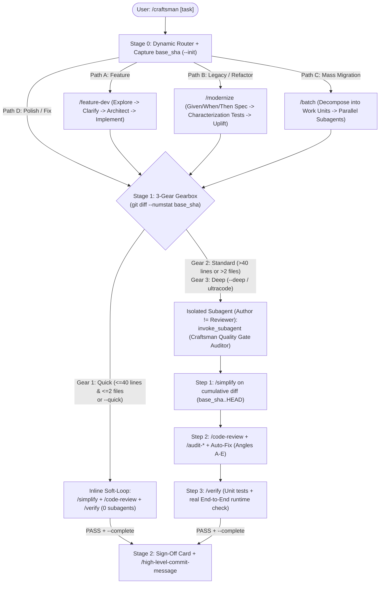

# Craftsman -- Agentic Engineering & Quality Gate Framework

[](https://github.com/BuczynskiRafal/craftsman/actions/workflows/ci.yml)
[](pyproject.toml)
[](pyproject.toml)
[](pyproject.toml)
[-brightgreen.svg)](pyproject.toml)
[](plugin.json)
[](LICENSE)

**Craftsman** is a zero-dependency **Agentic Software Engineering & Quality Gate Framework** (*Author != Reviewer*). It provides 17 structured engineering workflows, a **3-Gear Adaptive Quality Loop** (Soft-Loop vs. Context-Isolated Hard-Loop for **Google Antigravity**), multi-platform skill/rule exporters (**Claude Code**, **OpenAI Codex CLI**, **GitHub Copilot**, **Cursor**, **Windsurf**), and OS-level Git guardrails.

---

## Why Craftsman?

1. **Context-Isolated Review (`Author != Reviewer`):**
   AI coding agents exhibit confirmation bias when reviewing code they just wrote inside the same context window. For non-trivial changes in Google Antigravity, Craftsman's `Stop` hook inspects `transcript.jsonl` and blocks task completion until the primary agent spawns an isolated **`Craftsman Quality Gate Auditor` subagent** to execute `/simplify` -> `/code-review` -> `/verify` on the cumulative diff (`base_sha..HEAD`).
2. **3-Gear Automatic Gearbox (`Quick` vs. `Standard` vs. `Deep`):**
   No subagent overhead on 5-line fixes. Craftsman measures the cumulative git diff (`git diff --numstat <base_sha>`) and selects the appropriate verification tier:
   - **Gear 1 (`Quick` / Soft-Loop):** `<= 40` changed lines across `<= 2` files (or `/craftsman --quick`). Runs inline `/simplify` + `/code-review` + `/verify` with **zero subagent overhead**.
   - **Gear 2 (`Standard` / Hybrid Hard-Loop):** `> 40` changed lines or `> 2` files (or `/craftsman --standard`). Requires an isolated `Craftsman Quality Gate Auditor` subagent verified in `transcript.jsonl`.
   - **Gear 3 (`Deep` / Full-Audit Hard-Loop):** Triggered via `/craftsman --deep` or `ultracode`. Enforces pre-implementation `ultrathink` architecture analysis plus an isolated subagent executing all 5 specialized `/audit` suites.
3. **Write Once, Export Across AI Coding Agents:**
   Exports slash commands, prompt files, instructions, and rules from a single source of truth to **Google Antigravity** (`~/.gemini/config/`), **Claude Code** (`~/.claude/`), **GitHub Copilot** (`Code/User/prompts` and `.github/prompts/`), **OpenAI Codex / Windsurf / Zed** (`AGENTS.md`), **Cursor** (`.cursor/rules/craftsman.mdc`), and **native OS Git hooks** (`commit-msg`, `pre-push`, and local-hook forwarders).

---

## Platform Support Matrix & Threat Model

| Capability | Google Antigravity | Claude Code / GitHub Copilot / Codex / Cursor |
| :--- | :---: | :---: |
| **17 Engineering Skills / Slash Commands** | Native (`~/.gemini/config/skills/`) | Exported (`~/.claude/commands/`, `.github/prompts/`, `AGENTS.md`) |
| **Global Engineering & Git Rules** | Native (`~/.gemini/config/rules/`) | Exported (`~/.claude/rules/`, `.cursor/rules/`, `AGENTS.md`) |
| **Native OS Git Hooks (`commit-msg`, `pre-push`)** | Enforced | Enforced (across all IDEs & terminals) |
| **3-Gear Lifecycle Hooks (`PreToolUse`, `Stop`)** | Native (`hooks.json` + `transcript.jsonl`) | CLI state manager (`craftsman gate` / `craftsman status`) |

### Threat Model & Design Scope
Craftsman is an **engineering discipline harness**, not a security sandbox:
- **What it solves:** Prevents impatient or forgetful AI agents from skipping verification, reviewing their own large diffs inline with confirmation bias, accidentally pushing directly to `main`/`master` without asking, or polluting commit history with `Co-authored-by:` AI trailers.
- **What it does not claim to be:** It does not defend against an intentionally adversarial agent attempting to subvert local files or tamper with transcripts.

---

## Quick Start & Multi-Platform Installation

### Option A: Shell Installer

```bash
git clone https://github.com/BuczynskiRafal/craftsman.git ~/.craftsman
cd ~/.craftsman

# Install everywhere at once (Antigravity + Claude Code + GitHub Copilot + Global Git Hooks):
./install.sh --all

# For local development on Craftsman itself, use symlink mode to prevent config drift:
./install.sh --symlink --git-hooks
```

### Option B: Python CLI (`craftsman`)

Craftsman is a standard PEP 621 Python package (`python >= 3.10`) using only the Python standard library:

```bash
pip install .
# or editable mode:
pip install -e .

# Verify installation health, skill manifests, config drift, and active Git hooks:
craftsman doctor
craftsman doctor --json

# Inspect current repository cumulative diff and active Quality Gate Gear:
craftsman status --cwd /path/to/repo

# Export skills and rules to Claude Code, GitHub Copilot, Codex (AGENTS.md), and Cursor:
craftsman export --workspace /path/to/repo --agents-workspace /path/to/repo
```

### Target-Specific Installer Flags (`./install.sh`)

| Flag | Target Platform / Effect |
| :--- | :--- |
| `./install.sh --all` | Installs across **Google Antigravity**, **Claude Code**, **GitHub Copilot**, and **Global Git Hooks** in one shot. |
| `./install.sh --claude` | Exports all 17 slash commands (`~/.claude/commands/*.md`) and global rules (`~/.claude/rules/craftsman-rules.md`) for **Claude Code**. |
| `./install.sh --copilot` | Exports all 17 prompt files (`*.prompt.md`) and global instructions (`craftsman-rules.instructions.md`) to VS Code User profile for **GitHub Copilot Chat**. |
| `./install.sh --copilot-workspace <dir>` | Exports `.github/prompts/*.prompt.md` and updates `.github/copilot-instructions.md` (preserving existing content via `<!-- craftsman:begin/end -->` markers). |
| `./install.sh --agents-workspace <dir>` | Updates `AGENTS.md` (preserving existing content via `<!-- craftsman:begin/end -->` markers) and generates `.cursor/rules/craftsman.mdc`. |
| `./install.sh --git-hooks` | Installs OS-level `commit-msg` and `pre-push` hooks plus passthrough shims for all standard local hooks (`pre-commit`, `post-checkout`, etc.) into `~/.gemini/config/git-hooks`. |
| `./install.sh --symlink` / `--copy` | Installs skills, rules, `hooks.json` (merged non-destructively), and scripts into `~/.gemini/config/` for **Google Antigravity**. |

---

## 3-Gear Adaptive Architecture (`/craftsman`)



### Gearbox Comparison Table

| Gear | Trigger | Subagent Required? | Verification Scope | Best Used For |
| :--- | :--- | :---: | :--- | :--- |
| **Gear 1: `Quick` (Soft-Loop)** | Automatic when cumulative diff is **$\le 40$ lines across $\le 2$ files**, or manual `/craftsman --quick` | No (Fast Inline) | `/simplify` + `/code-review` + `/verify` in main thread | Config tweaks, small bugfixes, 1-2 file adjustments |
| **Gear 2: `Standard` (Hybrid Hard-Loop)** | Automatic when cumulative diff is **$> 40$ lines or $> 2$ files**, or manual `/craftsman --standard` | Yes (`Craftsman Quality Gate Auditor`) | Isolated subagent runs `/simplify` -> `/code-review` -> `/verify` on `base_sha..HEAD` | Everyday features, multi-file refactors, bugfix PRs |
| **Gear 3: `Deep` (Full-Audit Hard-Loop)** | Manual `/craftsman --deep` or keyword `ultracode` | Yes (`Craftsman Quality Gate Auditor`) | `ultrathink` pre-analysis + isolated subagent runs `/simplify` -> `/code-review` -> `/audit all` -> `/verify` | Critical core logic, security-sensitive modules, complex migrations |

---

## Included Skills (17 Core Engineering Workflows)

### 1. Master Orchestrator
| Command | Description |
| :--- | :--- |
| **`/craftsman`** | End-to-end engineering orchestrator. Tracks cumulative diff (`base_sha..HEAD`), selects architectural workflow (A-D), and enforces the 3-Gear Quality Gate. |

### 2. Architectural & Transformation Workflows
| Command | Description |
| :--- | :--- |
| **`/feature-dev`** | 7-phase feature development: codebase exploration -> clarifying questions -> 2-3 architectural trade-off options -> implementation -> review. |
| **`/modernize`** | Safe legacy modernization: extracts hidden business rules into `Given / When / Then` specs, builds characterization tests, refactors, and proves equivalence. |
| **`/batch`** | Parallel mass refactoring & migrations across 5-30 independent work units executed by background subagents. |

### 3. Daily Quality Gate
| Command | Description |
| :--- | :--- |
| **`/simplify`** | Behavior-preserving code cleanup across 4 angles: Reuse, Simplification, Efficiency, and Abstraction Altitude. |
| **`/code-review`** | 10-angle code review (local diff, branch, or GitHub/GitLab PR) with finding verification (`CONFIRMED` / `PLAUSIBLE` / `REFUTED`). |
| **`/verify`** | End-to-end runtime verification (CLI, HTTP server, data pipeline, headless GUI) beyond static unit tests. |
| **`/high-level-commit-message`** | Concise, high-level Conventional Commits message generator in American English. |

### 4. Specialized Deep Audits (`/audit`)
| Command | Description |
| :--- | :--- |
| **`/audit`** | Multi-aspect audit orchestrator (`/audit all`, `/audit errors,security`). |
| **`/audit-errors`** | *Silent Failure Hunter* -- detects swallowed exceptions, overly broad `try/except`, and silent `None`/`0`/`[]` fallbacks. |
| **`/audit-tests`** | *Behavioral Test Coverage* -- evaluates behavioral coverage, edge cases, and refactor resilience on a 1-10 scale. |
| **`/audit-types`** | *Type & Invariant Analyzer* -- audits domain models, dataclasses, and Pydantic schemas across 4 axes (*make illegal states unrepresentable*). |
| **`/audit-comments`** | *Comment Rot Analyzer* -- cross-checks docstrings and comments against actual implementation behavior. |
| **`/audit-security`** | *Source-to-Sink Taint Auditor* -- traces untrusted input to sensitive sinks with CWE classification and minimal patches. |

### 5. Performance & Code Hygiene
| Command | Description |
| :--- | :--- |
| **`/code-quality`** | Clean architecture audit focusing on DRY, SOLID, orthogonality, and naming consistency. |
| **`/extreme-optimizer`** | Iterative profile-driven performance optimization loop requiring benchmarks and output isomorphism proof. |
| **`/leetcode-style-code-reviewer`** | Competitive-programming-grade Python/NumPy/PyTorch hot-path performance review. |

---

## System Guards (`craftsman/` & `git-hooks/`)

1. **`craftsman.guard` / `scripts/git-guard.py` (`PreToolUse` hook + native `commit-msg` & `pre-push` Git hooks):**
   - **Rule #1 (Protected Branch Guard):** Blocks unconfirmed `git push` to `main`/`master` (including shell wrappers like `bash -c`, `timeout`, `eval`, git aliases, and `gh pr merge`) unless the user explicitly confirmed push/branch options via `ask_question` in the current workspace session or via an interactive terminal prompt.
   - **Rule #2 (Zero AI Attribution):** Rejects any commit, tag, or PR containing `Co-authored-by:` or `Generated by/with ...` AI trailers.
2. **`craftsman.gate` / `scripts/craftsman-stop-gate.py` (`Stop` hook + state CLI):**
   - Enforces the 3-Gear Quality Loop and `transcript.jsonl` verification for Gear 2 (`standard`) and Gear 3 (`deep`).

---

## Development & Verification

```bash
# Run linter, strict type checker, and behavioral test suite:
make check

# Or run individually:
ruff check craftsman scripts tests
mypy --strict craftsman scripts tests
python3 -m unittest discover -s tests -v
```

---

## License

Released under the [MIT License](LICENSE) (`Copyright (c) 2026 Rafał Buczyński`).
