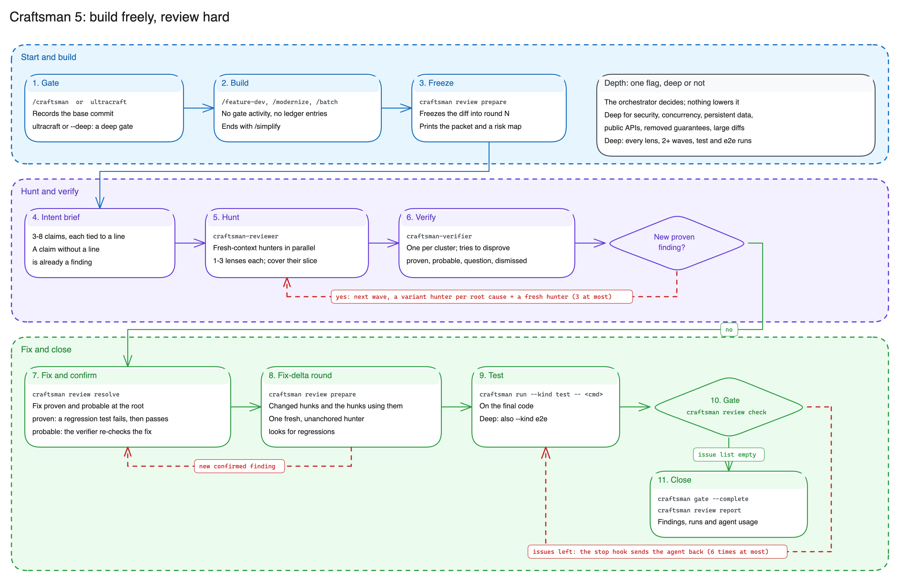

# Craftsman: make AI coding agents prove they reviewed their code

[](https://github.com/BuczynskiRafal/craftsman/actions/workflows/ci.yml)
[](plugin.json)
[](pyproject.toml)
[](pyproject.toml)
[](LICENSE)

Craftsman is a stop-hook quality gate that makes AI coding agents prove they reviewed and tested their code. When an agent says "done", the gate checks an evidence ledger and turns the agent back until review, verification, and tests have all passed on the final version of the code.

| Platform | Enforcement Mechanism |
| :--- | :--- |
| **GitHub Copilot in VS Code** | `Stop` hook blocks until review check passes; subagent isolation verified |
| **GitHub Copilot CLI** | `agentStop` hook enforces passing ledger |
| **Claude Code** | Native `Stop` hook and standalone Claude Code plugin |
| **Google Antigravity** | `Stop` hook validates ledger and subagent transcript execution |
| **Codex, Cursor, and AGENTS.md** | Protocol validated on exit by `craftsman gate --complete` |

<!-- Demo: see docs/assets/demo.gif -->

## Why

An agent's review of its own change usually fails for three reasons:

1. **The agent reads the diff, not the code.** Defects usually happen where the changed lines meet code the diff does not show: the rest of the function, its callers, shared state, tests. The **review packet** attaches the enclosing scope, call sites, and risk signals to each hunk.
2. **The agent judges while it searches.** It drops leads right away, stops at the first plausible explanation, and skips uncertain cases. The **two-phase protocol** splits these steps: lenses only collect findings, and a separate verifier tries to disprove and reproduce each one.
3. **Nothing checks that the review happened.** "Run /code-review before finishing" is only a hint. An agent in a hurry skips it or reviews 3 of 12 hunks. The **ledger** records coverage, verdicts, and runs, and the gate checks it before letting the agent finish.

## Benchmark (Pilot)

Pilot results on [SWR-Bench](https://doi.org/10.1145/3808144) (5 PRs, 9 confirmed defects, 1 repetition per configuration). Small sample; replication welcome. Claude Code pilot runs: see [docs/benchmark.md](docs/benchmark.md).

| Agent & Configuration | Without Craftsman | With Craftsman | Defects Found | Avg Time / PR | Findings |
| :--- | :---: | :---: | :---: | :---: | :---: |
| Antigravity · Gemini 4 Argon (`low`) | baseline | /code-review | 22% → **44%** (4/9) | 1.5 → 4.7 min | 4 → 11 |
| Antigravity · Gemini 4 Argon (`medium`) | baseline | /code-review | 22% → **56%** (5/9) | 2.0 → 6.7 min | 8 → 10 |
| Antigravity · Gemini 4 Argon (`high`) | baseline | /code-review | 33% → **78%** (7/9) | 15.6 → 26.3 min | 12 → 17 |

## Quickstart

```bash
pipx install craftsman-gate        # or: uv tool install craftsman-gate
craftsman install                  # auto-detects Claude Code, Copilot, Antigravity
/craftsman add pagination to the catalog search
```

For Claude Code plugin installation:

```bash
/plugin marketplace add BuczynskiRafal/craftsman && /plugin install craftsman@craftsman
```

## How It Works



1. **Prompt hook**: Records base commit and initializes session.
2. **Implementation & cleanup**: Builds the change and simplifies with `/simplify`.
3. **Review packet**: Computes hunks, enclosing scopes, callers, and risk signals.
4. **Lens passes**: Fresh-context reviewer subagents cover hunks and collect candidate findings.
5. **Challenge & fix**: Verifier attempts to disprove findings; orchestrator fixes proven defects.
6. **Gate check & verify**: Recorded test and e2e runs verify the final code before the stop gate allows completion.

See [docs/how-it-works.md](docs/how-it-works.md) for ledger schema, gears, and review lenses.

## Documentation

- [How it works](docs/how-it-works.md): Ledger schema, 12 review lenses, gears, execution loop
- [Installation](docs/installation.md): Installation flags, platform setup, Copilot discovery locations, doctor
- [Usage](docs/usage.md): Chat commands, review-only mode, frozen scope, archive retention
- [Guards](docs/guards.md): Stop gate state machine, work-tree guard, search scope guard
- [Skills](docs/skills.md): Catalog of all 17 bundled skills and companion tools
- [Benchmark](docs/benchmark.md): Full evaluation methodology, pilot results, replication guide
- [Architecture](docs/harness-architecture.md): Contributor guide to internals and state machines

## Contributing

See [CONTRIBUTING.md](CONTRIBUTING.md) for development workflows, testing guidelines, and commit conventions.

## Citation

```bibtex
@article{zeng2026swrbench,
  author    = {Zeng, Zhengran and Shi, Ruikai and Han, Keke and Li, Yixin and Sun, Kaicheng and Wang, Yidong and Yu, Zhuohao and Xie, Rui and Ye, Wei and Zhang, Shikun},
  title     = {{SWR-Bench}: Assessing {LLM} Performance in Real-World Code Review Comment Generation},
  journal   = {Proceedings of the ACM on Software Engineering},
  volume    = {3},
  number    = {FSE},
  articleno = {FSE137},
  year      = {2026},
  doi       = {10.1145/3808144}
}
```

## License

MIT, see [LICENSE](LICENSE) and attribution in [NOTICE](NOTICE).
