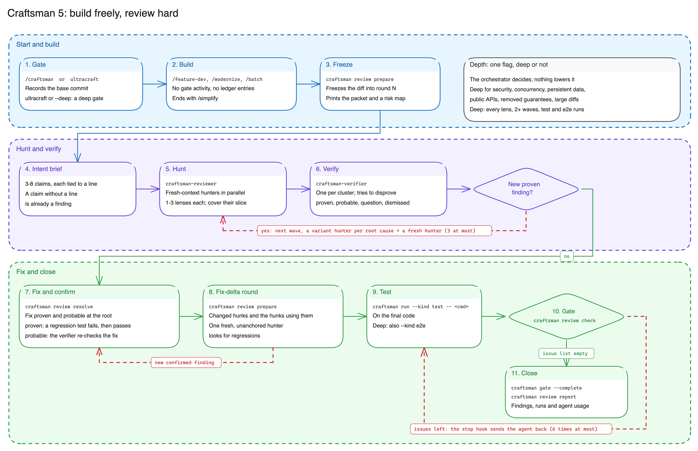

# Craftsman

[](https://github.com/BuczynskiRafal/craftsman/actions/workflows/ci.yml)
[](https://pypi.org/project/craftsman-gate/)
[](https://github.com/BuczynskiRafal/craftsman/blob/main/plugin.json)
[](https://github.com/BuczynskiRafal/craftsman/blob/main/docs/skills.md)
[](https://github.com/BuczynskiRafal/craftsman/blob/main/pyproject.toml)
[](https://github.com/BuczynskiRafal/craftsman/blob/main/pyproject.toml)
[](https://github.com/BuczynskiRafal/craftsman/blob/main/LICENSE)

AI coding agents usually judge their own work and stop as soon as things look green. Craftsman lets an agent **build freely, then forces a hard review**: when the agent thinks it is finished, Craftsman freezes the diff, sends fresh-context bug hunters and disproof-oriented verifiers over the change, logs verdicts and real test runs under `.git/`, and blocks completion in platform hooks until confirmed bugs are fixed and tests pass.

---

## Installation

Requires Python 3.10+ with zero external dependencies (`stdlib` only).

```bash
pipx install craftsman-gate        # or: uv tool install craftsman-gate
craftsman install                  # detects Claude Code, Copilot, and Antigravity
```

Or install as a platform plugin:

```bash
/plugin marketplace add BuczynskiRafal/craftsman              # Claude Code
/plugin install craftsman@craftsman
agy plugin install https://github.com/BuczynskiRafal/craftsman   # Antigravity
codex plugin marketplace add BuczynskiRafal/craftsman            # Codex
codex plugin add craftsman@craftsman
```

Cursor installs from a local checkout — see [Cursor plugin setup](https://github.com/BuczynskiRafal/craftsman/blob/main/docs/installation.md#cursor-plugin).

### Try the Skills Without Python

All 13 skills follow the [Agent Skills](https://agentskills.io) format and install directly via `skills.sh`:

```bash
npx skills add BuczynskiRafal/craftsman
# or pick individual skills:
npx skills add BuczynskiRafal/craftsman --skill audit-security --skill simplify
```

Eleven workflow and audit skills run standalone with no Python required, and `/craft-review` works standalone in ungated mode. Install `craftsman-gate` above when you want deterministic hunt plans, the `.git` evidence ledger, and Stop hooks that block premature exit. See the [skills catalog](https://github.com/BuczynskiRafal/craftsman/blob/main/docs/skills.md) and [installation guide](https://github.com/BuczynskiRafal/craftsman/blob/main/docs/installation.md).

## Usage

Describe the task in plain words — no flags to memorize:

```text
/craftsman add pagination to the catalog search
/craftsman migrate the session store to Redis, this is critical
/craft-review review my staged changes and fix what you find
/craft-review review PR 42
/craft-review be thorough, this touches authentication
```

The agent infers scope, whether to apply fixes, and review depth (scaling up automatically on risky signals or words like `critical` and `ultracraft`; see **Depth** in [`craft-review`](https://github.com/BuczynskiRafal/craftsman/blob/main/skills/craft-review/SKILL.md) and [docs/usage.md](https://github.com/BuczynskiRafal/craftsman/blob/main/docs/usage.md)). Run `craftsman status` at any time to check coverage and missing evidence.

## How It Works

| | Plain `CLAUDE.md` / prompt | External PR bots | Craftsman |
| :--- | :--- | :--- | :--- |
| **When it runs** | Only if the agent remembers | After a PR is opened | Before the agent stops, on the local diff |
| **Who checks** | Same context that wrote the bug | One remote PR pass | Fresh-context hunters + verifiers trying to disprove reports |
| **Completion proof** | Agent claims tests pass | PR review comments | Git-local ledger of covered hunks, verdicts, and `craftsman run` passes |
| **Setup** | Prompt text only | Cloud service / webhook | Stdlib-only Python CLI or standalone Agent Skills |



1. **Freeze and plan.** The diff is frozen and split by size and risk signals into mandatory hunt slices and lenses.
2. **Hunt.** Fresh-context agents inspect each slice and record suspected bugs with concrete triggers.
3. **Verify.** Separate verifiers try to disprove every suspicion and reproduce survivors; confirmed bugs trigger follow-up waves.
4. **Fix and test.** Root-cause fixes are re-checked by fresh hunters and verified by `craftsman run` on the final code.

`/craft-review` runs steps 1–3 on an existing change and applies fixes only when asked. Full protocol: [docs/how-it-works.md](https://github.com/BuczynskiRafal/craftsman/blob/main/docs/how-it-works.md).

## What the Gate Looks Like

Captured on the [catalog pagination demo](https://github.com/BuczynskiRafal/craftsman/blob/main/examples/demo/README.md) (`./setup.sh` on POSIX, `.\setup.ps1` on Windows):

**1. Stopping early triggers the Stop hook:**

```text
[CRAFTSMAN GATE 1/6] review incomplete: no passing test run; no reviewer isolation evidence. Task completion is blocked until the evidence ledger proves the change is reviewed and verified.
Next actions:
1. [no-isolation] No Craftsman subagent was recorded for round 1. ...
2. [no-passing-run] No passing test or e2e run at the current code; run `craftsman run --kind test -- <your test command>`.
Close the gate with `craftsman gate --complete` once `craftsman review check` passes.
```

**2. After verification, fixes, and tests pass, `craftsman review report` shows the ledger:**

```text
$ craftsman review report
- Base `7a8b04a` · 2 review round(s) · 2 files, +48/−10 lines
- Gate: PASSED

## Findings
**Fixed (2)**
- F1 · major · `shop/catalog.py:37` — total_pages truncates partial pages via floor division. Fix: Used ceiling division; confirmed by test_list_products_partial_last_page (R3).
- F2 · major · `shop/catalog.py:36` — page < 1 uses negative slice indices instead of raising ValueError. Fix: Added page >= 1 and page_size >= 1 checks; confirmed by test_list_products_rejects_non_positive_page (R3).

## Verification at the final code
- R3 `python -m unittest discover -s tests` (test) → exit 0 in 0.2s
```

## Platforms

| Platform | What blocks completion |
| :--- | :--- |
| Claude Code | `Stop` hook |
| GitHub Copilot in VS Code | `Stop` hook |
| GitHub Copilot CLI | `agentStop` hook |
| Google Antigravity | `Stop` hook |
| Codex, Cursor, and `AGENTS.md` tools | `craftsman gate --complete` |

Where a host does not expose subagent hooks (Codex, Cursor, or unhooked sessions), the review stays advisory once every hunk is covered and marks the report `SELF-REVIEWED`.

## Measurements

Seeded-defect A/B benchmark on [`evals/`](https://github.com/BuczynskiRafal/craftsman/blob/main/evals/README.md) (`8` cases, `27` defects, `18` decoys) using `gemini-3.8-flash-low` via Antigravity (`agy -p`, Craftsman `5.1.0` vs. unassisted baseline, `2` passes = `32` runs):

- **Recall**: `89%` (`24.00/27`) without Craftsman → **`98%`** (`26.50/27`, `27/27` in pass 2, `+9.3 pts`, 90% Welch CI `-2.4 to +21.0 pts`), catching all three defects the baseline missed in both passes (`inv-2`, `od-6`, `tb-3`).
- **Trade-offs**: precision `100%` → `83%` (`1.50` decoy hits and `29.00` unmatched findings/pass), time `11.9` → `144.1 min`/pass (`×12.14`, with two pass-1 timeouts at 30 min), tokens `3.3M` → `111.3M`/pass (`×33.54`, `84.8%` in subagents).

Best suited for hard changes, legacy migrations, and high-stakes code — unnecessary for quick prototypes or trivial fixes. Full tables and limits: [docs/benchmark.md](https://github.com/BuczynskiRafal/craftsman/blob/main/docs/benchmark.md).

## Documentation

- [Usage](https://github.com/BuczynskiRafal/craftsman/blob/main/docs/usage.md) · [How it works](https://github.com/BuczynskiRafal/craftsman/blob/main/docs/how-it-works.md) · [Installation](https://github.com/BuczynskiRafal/craftsman/blob/main/docs/installation.md) · [Guards](https://github.com/BuczynskiRafal/craftsman/blob/main/docs/guards.md) · [Skills](https://github.com/BuczynskiRafal/craftsman/blob/main/docs/skills.md) · [Benchmark](https://github.com/BuczynskiRafal/craftsman/blob/main/docs/benchmark.md) · [Demo](https://github.com/BuczynskiRafal/craftsman/blob/main/examples/demo/README.md) · [Architecture](https://github.com/BuczynskiRafal/craftsman/blob/main/docs/harness-architecture.md)

## Contributing & License

Contributions: [CONTRIBUTING.md](https://github.com/BuczynskiRafal/craftsman/blob/main/CONTRIBUTING.md) · Citation: [CITATION.cff](https://github.com/BuczynskiRafal/craftsman/blob/main/CITATION.cff) · License: MIT ([LICENSE](https://github.com/BuczynskiRafal/craftsman/blob/main/LICENSE), [NOTICE](https://github.com/BuczynskiRafal/craftsman/blob/main/NOTICE)).
