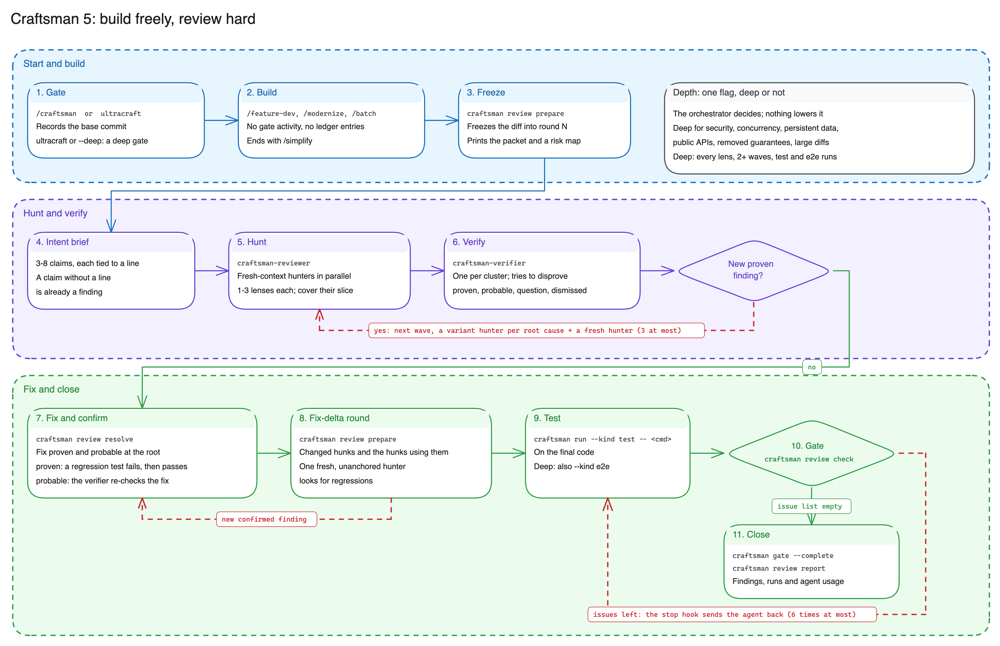

# Craftsman

[](https://github.com/BuczynskiRafal/craftsman/actions/workflows/ci.yml)
[](https://pypi.org/project/craftsman-gate/)
[](plugin.json)
[](docs/skills.md)
[](pyproject.toml)
[](pyproject.toml)
[](LICENSE)

Craftsman to pętla kontrolna, w której zamykany jest agent kodujący AI. Zwykle agent sam ocenia swoją pracę i ogłasza zakończenie zadania. W Craftsmanie nie może zakończyć pracy, dopóki nie udowodni, że jego zmiana została zrecenzowana i przetestowana.

Craftsman nie ingeruje w to, jak agent pisze kod; zasada brzmi **koduj swobodnie, recenzuj surowo** (*build freely, review hard*). Recenzja zaczyna się dopiero wtedy, gdy agent uzna zadanie za ukończone. Jego zmiana (diff) zostaje zamrożona, a kod sprawdzają agenci, którzy go nie pisali i widzą go po raz pierwszy. Jedni polują na błędy; inni próbują podważyć każde zgłoszenie, tak aby przetrwały wyłącznie prawdziwe defekty. Polowanie trwa tak długo, jak długo kolejne fale wykrywają realne błędy. Agent je naprawia i kończy zadanie dopiero wtedy, gdy testy przejdą na finalnym kodzie.

Dowody trafiają do rejestru w katalogu `.git`: kto sprawdził którą część zmiany, jak oceniono każde zgłoszenie i dlaczego oraz w jaki sposób wykonano testy. Gdy agent próbuje zakończyć pracę, hook platformy czyta rejestr i zawraca go z listą brakujących elementów. Liczą się rzeczywiste wyniki, a nie deklaracje agenta. Błąd samego hooka jest zawsze logowany — nigdy przemilczany.

Narzędzie działa z Claude Code, GitHub Copilot i Google Antigravity. W Codex i Cursorze ten sam protokół działa bez hooków.

## Czym to się różni

| | Zwykły `CLAUDE.md` / prompt | Zewnętrzne boty PR | Craftsman |
| :--- | :--- | :--- | :--- |
| **Kiedy działa** | Tylko jeśli agent o tym pamięta | Po otwarciu pull requesta | Zanim agent zdoła zakończyć pracę, na lokalnym diffie |
| **Kto sprawdza kod** | Ten sam kontekst, który napisał błąd | Pojedynczy zdalny przegląd PR-a | Świeżokontekstowi łowcy + weryfikatorzy próbujący obalić każde zgłoszenie |
| **Co oznacza „gotowe”** | Agent twierdzi, że testy przechodzą | Komentarze z recenzji na GitHubie | Lokalny rejestr w `.git` z pokrytymi hunkami, odtworzonymi werdyktami i przejściem `craftsman run` |
| **Środowisko i setup** | Sam tekst promptu | Usługa chmurowa / webhook repozytorium | Lokalne CLI w Pythonie (tylko stdlib, zero zależności) lub samodzielne Agent Skills |

## Jak to działa



Agent buduje rozwiązanie po swojemu; Craftsman w tym czasie niczego nie recenzuje. Gdy agent uzna zadanie za zakończone, recenzja przebiega w czterech krokach:

1. **Zamrożenie i plan.** Diff zostaje zamrożony, a CLI dzieli go na porcje do sprawdzenia (sloty). Każda porcja to fragment zmiany wraz z perspektywami (soczewkami), przez które należy go zbadać. Liczbę porcji wyznaczają rozmiar diffa oraz sygnały ryzyka, a nie to, na ile model akurat ma ochotę się przyłożyć. Agent nie może pominąć żadnej porcji.
2. **Polowanie na błędy.** Każda porcja trafia do osobnego agenta ze świeżym kontekstem. Zapisuje on każdy podejrzewany błąd wraz z konkretną sytuacją, która go wyzwala.
3. **Weryfikacja.** Osobni agenci próbują obalić każde podejrzenie, a te, które przetrwają, odtwarzają na kodzie. Łowcy nie mogą niczego przeoczyć; weryfikatorzy muszą odsiać fałszywe alarmy. Dopóki fala polowania potwierdza choć jeden błąd, uruchamiana jest kolejna.
4. **Poprawki i testy.** Agent naprawia potwierdzone błędy u źródła, świeżokontekstowi łowcy ponownie sprawdzają poprawki, a testy uruchamiają się przez `craftsman run` na finalnej wersji kodu.

`/craft-review` przeprowadza tę samą recenzję na istniejącej zmianie i wprowadza poprawki wyłącznie wtedy, gdy o to poprosisz.

Pełny protokół wraz ze schematami znajduje się w [docs/how-it-works.md](docs/how-it-works.md).

## Jak to wygląda w praktyce

Zarejestrowane na [demie paginacji katalogu](examples/demo/README.pl.md) (`./setup.sh` w systemach POSIX, `.\setup.ps1` w systemie Windows):

**1. `craftsman review prepare` buduje plan polowania na podstawie diffa**

```text
$ craftsman review prepare --task "Add 1-based pagination to catalog search results (page number and optional page size)"
Round 1 prepared: 2 files, 2 hunks, 45 changed lines; 0 hunks carried, 2 to review.
Packet: .git/craftsman/packet-1.md
Depth: normal (no deep signal; 33 changed production lines <= 250)
Enforced: Copilot hooks serve this review; finishing requires every slot below.
Hunt plan, round 1:
  W1-1  H1-H2  intent, ripple, tests       45 lines
  W1-2  H1-H2  contracts, failure, sweep   45 lines
  W1-3  H1     model                       33 lines
  W1-4  H1-H2  craft, design (simplicity)  45 lines  [Claude Code: model haiku]
```

**2. Jeśli agent próbuje zakończyć przedwcześnie, hook Stop cofa go do pracy**

```text
[CRAFTSMAN GATE 1/6] review incomplete: no passing test run; no reviewer isolation evidence. Task completion is blocked until the evidence ledger proves the change is reviewed and verified.
Next actions:
1. [no-isolation] No Craftsman subagent was recorded for round 1. ... launch them now, all in one step: W1-1..W1-3; W1-4 [Claude Code: model haiku].
2. [no-passing-run] No passing test or e2e run at the current code; run `craftsman run --kind test -- <your test command>`.
Close the gate with `craftsman gate --complete` once `craftsman review check` passes.
```

**3. Gdy łowcy, weryfikatorzy, poprawki, 2. runda i testy przejdą, `craftsman review report` pokazuje dowody**

```text
$ craftsman review report
- Base `7a8b04a` · 2 review round(s) · 2 files, +48/−10 lines
- Gate: PASSED

## Hunt
Hunt: 6 slots - 6 done
  W1-1   H3-H4  intent, ripple, tests                58 lines  [done]
  W1-2   H3-H4  contracts, failure, sweep            58 lines  [done]
  W1-3   H3     model                                37 lines  [done]
  W1-4   H3-H4  craft, design (simplicity)           58 lines  [done] [Claude Code: model haiku]
  W2-X1  H3-H4  state, trust, platform (fresh look)  58 lines  [done]
  W2-F1  H3     contracts (variant of F1)            37 lines  [done]

## Findings
**Fixed (2)**
- F1 · major · `shop/catalog.py:37` — total_pages truncates partial pages via floor division. Fix: Used ceiling division in shop/catalog.py; confirmed by test_list_products_partial_last_page (R3).
- F2 · major · `shop/catalog.py:36` — page < 1 uses negative slice indices instead of raising ValueError. Fix: Added page >= 1 and page_size >= 1 checks; confirmed by test_list_products_rejects_non_positive_page (R3).

## Verification at the final code
- R3 `python -m unittest discover -s tests` (test) → exit 0 in 0.2s
- R4 `python -m unittest discover -s tests` (test) → exit 0 in 0.1s
```

## Gdzie sprawdza się najlepiej

Craftsman najlepiej sprawdza się w zadaniach takich jak:

- pisanie trudnych, nietrywialnych rozwiązań,
- praca z kodem zastanym (legacy),
- przenoszenie starej bazy kodu na nowe rozwiązanie,
- problemy naukowe, w których liczy się pewność co do poprawności wyniku.

Dobrze współpracuje z tanimi modelami, a jeszcze lepiej z modelami hostowanymi lokalnie.

Nie jest potrzebny przy szybkich prototypach i drobnych poprawkach.

## Platformy

| Platforma | Co blokuje zakończenie |
| :--- | :--- |
| Claude Code | Hook `Stop` |
| GitHub Copilot w VS Code | Hook `Stop` |
| GitHub Copilot CLI | Hook `agentStop` |
| Google Antigravity | Hook `Stop` |
| Codex, Cursor i inne narzędzia czytające `AGENTS.md` | `craftsman gate --complete` |

Tam, gdzie platforma nie może potwierdzić, że recenzję wykonał osobny subagent (Codex, Cursor albo sesja bez hooków), recenzja ma charakter doradczy: kończy się po pokryciu każdego hunka, bramka nadal się zamyka, a raport oznacza ją jako `SELF-REVIEWED`.

## Pomiary

Pilotaż na [SWR-Bench](https://doi.org/10.1145/3808144): 5 prawdziwych pull requestów z `pytest`, `flask` i `requests`, każdy zrecenzowany z Craftsmanem oraz bez niego w dziewięciu konfiguracjach modeli.

- Znalezione uwagi ludzkich recenzentów: 16 bez Craftsmanna, **30 z Craftsmanem** (na 81).
- Błędy niewskazane przez żadnego ludzkiego recenzenta, odtworzone skryptem: 22 bez Craftsmanna, **30 z Craftsmanem** (na 54).

Zestaw z zasianymi defektami (`evals/`, 8 przypadków, 27 defektów, 18 pułapek) na `gemini-3.8-flash-low` przez Antigravity (`agy -p`, Craftsman 5.1.0 vs. baseline bez wsparcia, 2 pełne przebiegi, 32 uruchomienia):

- **Skuteczność wykrywania (recall)**: `89%` (`24.00/27`) bez Craftsmanna → **`98%`** (`26.50/27`, `27/27` w 2. przebiegu) z Craftsmanem (`+9.3 pkt`, 90% przedział Welcha `-2.4 do +21.0 pkt`). Craftsman wykrył wszystkie trzy defekty, które baseline pominął w obu przebiegach (`inv-2`, `od-6`, `tb-3`).
- **Kompromisy**: precyzja `100%` → `83%` (`1.50` trafień w pułapki i `29.00` niedopasowanych znalezisk na przebieg), czas rzeczywisty `11.9 min` → `144.1 min` na przebieg (`×12.14`, dwa duże uruchomienia w 1. przejściu osiągnęły limit 30 min), zużycie tokenów `3.3M` → `111.3M` na przebieg (`×33.54`, `84.8%` w subagentach).

Pełne tabele i ograniczenia: [docs/benchmark.md](docs/benchmark.md).

Zestaw z zasianymi defektami w [`evals/`](evals/README.pl.md) pozwala zmierzyć recall i koszt na dowolnej platformie agentowej.

## Instalacja

Wymaga Pythona 3.10+ bez żadnych zewnętrznych zależności.

```bash
pipx install craftsman-gate        # lub: uv tool install craftsman-gate
craftsman install                  # wykrywa Claude Code, Copilot i Antigravity
```

Albo jako wtyczka:

```bash
/plugin marketplace add BuczynskiRafal/craftsman              # Claude Code
/plugin install craftsman@craftsman
agy plugin install https://github.com/BuczynskiRafal/craftsman   # Antigravity
codex plugin marketplace add BuczynskiRafal/craftsman            # Codex
codex plugin add craftsman@craftsman
```

W Codex i Cursorze wtyczka dostarcza skille (a w Cursorze także zawsze aktywną regułę), ale bez hooków, więc recenzja pozostaje tam doradcza. Cursor instaluje ją jako lokalną wtyczkę; zobacz [docs/installation.md](docs/installation.md#cursor-plugin).

### Wypróbuj skille bez instalacji Pythona

Wszystkie 13 skilli są zgodne ze standardem [Agent Skills](https://agentskills.io) i można je zainstalować bezpośrednio przez `skills.sh`:

```bash
npx skills add BuczynskiRafal/craftsman
# albo wybierz tylko potrzebne samodzielne skille:
npx skills add BuczynskiRafal/craftsman --skill audit-security --skill simplify
```

Jedenaście skilli audytowych i workflowowych (`feature-dev`, `modernize`, `batch`, `simplify`, `verify`, `audit`, `audit-comments`, `audit-errors`, `audit-security`, `audit-tests` i `audit-types`) działa w pełni samodzielnie bez Pythona, dołączając w razie potrzeby własne playbooki `references/<lens>-lens.md`. `/craft-review` również działa samodzielnie (bez egzekwującej bramki) z użyciem wbudowanego [`lenses.md`](skills/craft-review/lenses.md).

Zainstaluj `craftsman-gate`, jeśli chcesz mieć wymuszaną pętlę: deterministyczne plany polowania, `craftsman review scout`, rejestr dowodów w `.git` oraz hooki Stop blokujące przedwczesne zakończenie pracy. Zobacz [katalog skilli](docs/skills.md) i [przewodnik instalacji](docs/installation.md).

## Użycie

Wpisz polecenie zwykłym językiem. Nie trzeba pamiętać żadnych flag.

```
/craftsman add pagination to the catalog search
/craftsman migrate the session store to Redis, this is critical
/craft-review review my staged changes and fix what you find
/craft-review review PR 42
/craft-review be thorough, this touches authentication
```

Agent sam ustala cel recenzji (katalog roboczy, zmiany w stagingu, gałąź, PR), to, czy ma wprowadzać poprawki, oraz wymaganą głębokość. Dla ryzykownych zmian lub gdy poprosisz o szczególną staranność („critical”, „be thorough”, `ultracraft`) automatycznie przechodzi na tryb głęboki; pełna lista wyzwalaczy znajduje się w sekcji **Depth** w [skillu `craft-review`](skills/craft-review/SKILL.md). Głębokość nigdy nie spada w trakcie sesji. Końcowy raport wyjaśnia, co agent postanowił i dlaczego. Zobacz [docs/usage.md](docs/usage.md).

`craftsman status` pokazuje bieżącą rundę, pokrycie oraz brakujące dowody.

## Dokumentacja

- [Użycie](docs/usage.md): przykładowe polecenia, decyzje podejmowane przez agenta, opcjonalne flagi
- [Jak to działa](docs/how-it-works.md): pełny protokół, plan polowania, co czytają łowcy, rejestr, bramka, soczewki, egzekwowanie na platformach
- [Instalacja](docs/installation.md): flagi, konfiguracja platform, Agent Skills (`npx skills add`), odinstalowanie, `craftsman doctor`
- [Strażnicy (Guards)](docs/guards.md): automat stanowy bramki, strażnik recenzji, polityka poleceń, zakres wyszukiwania, log błędów hooków
- [Skille](docs/skills.md): katalog skilli samodzielnych i bramkowanych
- [Benchmark](docs/benchmark.md): metodologia, wyniki, replikacja
- [Demo](examples/demo/README.pl.md): odizolowane demo paginacji katalogu (`setup.sh` / `setup.ps1`)
- [Architektura](docs/harness-architecture.md): wnętrze projektu dla współtwórców

## Współpraca

Zobacz [CONTRIBUTING.md](CONTRIBUTING.md).

## Cytowanie

Aby zacytować samego Craftsmanna, zobacz [CITATION.cff](CITATION.cff). Dla zbioru pilotażowego SWR-Bench:

```bibtex
@article{zeng2026swrbench,
  author    = {Zeng, Zhengran and Shi, Ruikai and Han, Keke and Li, Yixin and Sun, Kaicheng and Wang, Yidong and Yu, Zhuohao and Xie, Rui and Ye, Wei and Zhang, Shikun},
  title     = {{SWR-Bench}: Assessing {LLM} Performance in Real-World Code Review Comment Generation},
  journal   = {Proceedings of the ACM on Software Engineering},
  volume    = {3},
  number    = {FSE},
  articleno = {FSE137},
  year      = {2026},
  doi       = {10.1145/3808144}
}
```

## Licencja

MIT, zob. [LICENSE](LICENSE) oraz informacje o atrybucji w [NOTICE](NOTICE).
