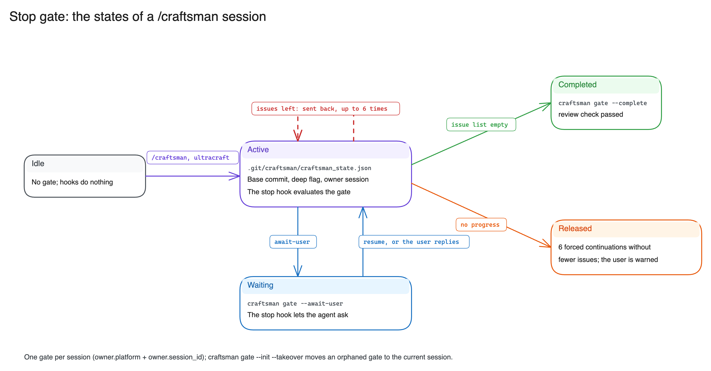

# Guardrails & Safety Architecture

Craftsman protects repository integrity and enforces review honesty through three distinct runtime guards:
the **Stop Gate**, the **Work-tree Mutation Guard**, and the **Repository Search Scope Guard**.

---

## Stop Gate



The Stop Gate prevents AI coding assistants from prematurely concluding tasks when code changes remain unreviewed,
unverified, or failing tests:

- **State storage**: Gate state is persisted in `<git-dir>/craftsman/craftsman_state.json`, alongside the evidence ledger.
- **Session ownership**: Each gate is strictly bound to the specific agent session (`owner.platform` + `owner.session_id`)
  that opened it. Parallel agent sessions in the same work tree cannot corrupt, advance, or be halted by another session's gate.
- **Explicit takeover**: If a session terminates unexpectedly or a user desires to assume control of an orphaned gate,
  `craftsman gate --init --takeover` transfers session ownership safely.
- **Forced continuation cap**: To prevent infinite loops caused by pathological agent behavior, the stop gate permits
  completion after six consecutive forced continuations if no decrease in open defects is detected, alerting the user
  that the gate was not satisfied.
- **Fail-closed posture**: Malformed or unreadable gate states cause immediate warnings, while tool permission checks
  fail closed to protect the repository.

### Review stop guard

`/craft-review` has no gate, so the prompt hook leaves a marker (`review_hooks.json`, next to the ledger) for the
session that invoked it, and the Stop hook holds that session to the review-only outcome. Only Craftsman's own
`/craft-review` arms it; the host agent's built-in `/code-review` neither arms it nor opens a gate.

- The guard judges the review with the same rules and the same isolation evidence as
  `craftsman review check --review-only`. Hooks count as evidence when the marker names the session the command runs in
  (Claude Code only; other platforms export no session id to commands) or when a reviewer or verifier event arrived
  after the current round was prepared. Events of an earlier session prove nothing about this one.
- The guard ends when the user moves on to another request, not when the platform speaks for the session: a stop hook's
  own block reason and a background subagent's report (`<task-notification>`, `Another Claude session sent a message:`)
  leave it armed.
- Running `craftsman review prepare` counts as starting the review even when the diff is unchanged or the depth was
  only raised.
- While a Craftsman reviewer or verifier that started in this review has not stopped (a background subagent), the guard
  lets the agent wait for it: its completion wakes the session, and no reminder is spent.
- Otherwise a review with hunks uncovered, findings without a verdict, no reviewer run or hunks covered outside any
  reviewer run is sent back, up to six times without progress. Coverage must come from a `craftsman-reviewer`, which
  Claude Code attributes by the reviewer's own transcript within its run's time window, and other platforms (or an unclear transcript) by time alone; findings may come from anyone.

---

## Work-tree Mutation Guard

Implemented in `craftsman/worktree_guard.py` and invoked via `craftsman hook pre-tool`:

- **Reviewer protection**: During an active review round, `craftsman-reviewer` and `craftsman-verifier` subagents
  are denied access to commands that modify the work tree or index:
  - `git stash` (except `list`, `show`, `create`)
  - `git reset`, `git checkout`, `git switch`, `git restore`, `git clean`
  - Subagent git mutations: `commit`, `merge`, `rebase`, `cherry-pick`, `revert`, `am`, `apply`, `pull`, `rm`, `mv`
- **User confirmation in main sessions**: If the main agent session attempts a worktree-mutating git command while
  a review-only round is open, the hook prompts the user for confirmation (`ask`).
- **Platform enforcement**: Intercepted in real time on Claude Code, GitHub Copilot in VS Code, and GitHub Copilot CLI.

---

## Repository Search Scope Guard

Implemented in `craftsman/scope.py` and invoked via `craftsman hook pre-tool` (or `craftsman scope-guard` on Antigravity):

Confines automated tools and subagents to the current repository, preventing data leakage across private projects
and preventing agents from wandering into external directories:

### Allowed Operations
- Reading, listing, and searching within the active git work tree (`git rev-parse --show-toplevel`, including submodules).
- File operations within dedicated temporary directories in the system `$TMPDIR` (`/tmp`).
- Direct single-file reads or non-recursive directory listings outside the work tree (such as reading standard library files
  or dependencies cited in tracebacks), provided the target is not inside another git repository or sensitive directory.

### Blocked Operations
- Recursive searches (`find`, `rg`, `grep -R`, `fd`, `ls -R`, `tree`, `Glob`, `Grep`, `LS`) rooted outside the work tree
  (e.g., `~`, `..`, `/home`, `/Users`, or sibling directories).
- Accessing other git repositories or agent session transcripts:
  - `~/.claude/projects/`
  - `~/.copilot/session-state/`
  - `~/.gemini/antigravity/brain/` and `~/.gemini/antigravity/conversations/`
  - External `.git/craftsman/` directories
  - User shell history files (`.bash_history`, `.zsh_history`)

### Configuration (per repository via Git config)

```bash
# Allow specific external directories (colon-separated on POSIX, semicolon on Windows):
git config --add craftsman.scopeAllow ../shared-schemas

# Configure enforcement mode: deny (default, blocks), warn (logs warning), or off (disabled):
git config craftsman.scope warn
git config craftsman.scope off
```
