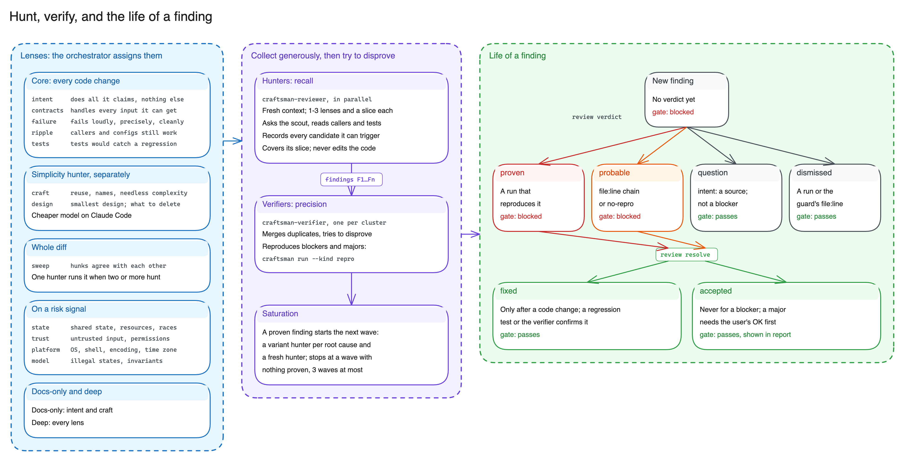
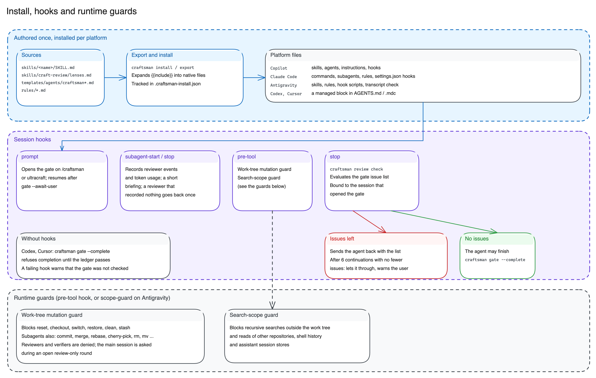

# Craftsman Harness Architecture

Craftsman is an engineering harness that makes AI coding agents prove they reviewed and tested their change. Instead of prompt-only advice ("remember to review and test"), it couples **budgeted, context-enriched review packets**, a **hunt-and-verify protocol** (high-recall hunters decoupled from adversarial verifiers), **pinned review scopes**, and a **fingerprinted evidence ledger** enforced at runtime by IDE/CLI lifecycle hooks.

The design rule is "build freely, review hard": the build phase has no gate activity, and the gate judges outcomes on the final diff. The amount of review work is computed from the diff, never left to how hard the model feels like trying: `review prepare` turns the diff into a **hunt plan** (slots of hunks and lenses, `craftsman/huntplan.py`), stores it in the round, and an enforced review is complete only when every slot is done. The orchestrating agent launches the slots, verifies, fixes and decides depth beyond the signals; it cannot drop a slot.

This reference covers the architecture, state machines, data structures, and invariants. The protocol itself, with its flow and ledger diagrams, is explained once, in [how-it-works.md](how-it-works.md); this page does not repeat it.

### Diagrams

The diagrams in `docs/diagrams/` are editable Excalidraw scenes rendered to PNG:

```bash
npx @excalidraw/cli render docs/diagrams/<name>.excalidraw \
  --out docs/diagrams/<name>.png --scale 2 --max-width 4096 --max-height 4096
```

| Diagram | Shows | Source | Image |
| :--- | :--- | :--- | :--- |
| **Workflow** | From `/craftsman` to a closed gate: build, freeze, hunt, verify, waves, fix, test | [`harness-overview.excalidraw`](diagrams/harness-overview.excalidraw) | [`harness-overview.png`](diagrams/harness-overview.png) |
| **Evidence ledger** | What `review prepare` builds, what the ledger records, which hunks the next round re-reviews, when the gate passes | [`evidence-ledger-flow.excalidraw`](diagrams/evidence-ledger-flow.excalidraw) | [`evidence-ledger-flow.png`](diagrams/evidence-ledger-flow.png) |
| **Hunt and verdicts** | Lenses, hunters, verifiers, saturation, and the evidence each verdict and resolution needs | [`review-protocol-and-verdicts.excalidraw`](diagrams/review-protocol-and-verdicts.excalidraw) | [`review-protocol-and-verdicts.png`](diagrams/review-protocol-and-verdicts.png) |
| **Install, hooks and guards** | What `craftsman install` writes, what each session hook does, the stop hook's outcomes, the runtime guards | [`lifecycle-hooks-and-guards.excalidraw`](diagrams/lifecycle-hooks-and-guards.excalidraw) | [`lifecycle-hooks-and-guards.png`](diagrams/lifecycle-hooks-and-guards.png) |
| **Stop gate** | The states of a `/craftsman` session | [`stop-gate.excalidraw`](diagrams/stop-gate.excalidraw) | [`stop-gate.png`](diagrams/stop-gate.png) |

---

## 1. Session Lifecycle

Every `/craftsman` (or `ultracraft`) session is tracked in `.git/craftsman/craftsman_state.json`:

1. **Gate initialization (`craftsman.gate`).** The platform's `UserPromptSubmit` / `userPromptSubmitted` hook runs it when the prompt contains `/craftsman` or `ultracraft`; otherwise run `craftsman gate --init [--deep] --task "<description>"`.
   - It captures `base_sha`: `git rev-parse HEAD`, or the Git empty-tree SHA (`4b825dc642cb6eb9a060e54bf8d69288fbee4904`) in a repository with no commits.
   - A ledger of a different `base_sha` is archived by `archive_ledger()` (`craftsman.evidence`) to `ledger-<timestamp>.json`, old packets move to `archive-<timestamp>/`, and archives beyond `CRAFTSMAN_KEEP_ARCHIVES` (default `5`) are pruned.
   - `craftsman gate --await-user` pauses the `Stop` hook while the agent waits for the user's answer; `craftsman gate --resume` continues. A gate state file from before 5.0 is archived to `craftsman_state.json.v4.bak` on first read and a fresh gate starts; `--takeover` is only for a gate that another live session owns.
2. **Build.** No gate activity. The agent picks `/feature-dev`, `/modernize`, `/batch`, or a direct change, runs tests and tools freely, and ends with `/simplify`.
3. **Final review.** `craftsman review prepare --task-file -` freezes the diff into round N (the task text is the orchestrator's intent brief) and stores the hunt plan. The orchestrator launches every slot, runs `review check` after each report and launches what it lists (verifiers, later waves), fixes confirmed defects, prepares a fresh round for the fix delta, and runs the tests (section 6). Subagents write ledger entries through the CLI.
4. **Completion.** `craftsman review check` (and the `Stop` hook) evaluates the gate issue list against the live work tree. `craftsman gate --complete` marks `active = False, stage = "completed"`, and `craftsman review report` prints the audit report.

### Depth

The gate has one flag, `deep: bool`. `craftsman gate --init --deep` (or `ultracraft`, or the orchestrator's later `review prepare --deep`) sets it. Re-running either command on an active gate raises it; nothing lowers it. Deep makes the gate require a passing `e2e` run (besides the passing test run) and makes the plan owe every lens on every production hunk, with a fresh second look planned up front. `huntplan.decide_depth` also makes a round deep by itself: a deep-hint signal (`process`, `sql`, `deserialization`, `auth`, `concurrency`) in a production hunk, or at least `DEEP_MIN_PRODUCTION_LINES = 251` changed production lines (data, lockfiles, generated files, tests and prose do not count). `prepare` prints `Depth: deep (<reasons>)` or `Depth: normal (no deep signal; N changed production lines <= 250)`. The judgment calls that go beyond the signals are listed once, under **Depth** in `skills/craft-review/SKILL.md`. In review-only mode (no gate) `review prepare --deep` makes that round deep.

---

## 2. Work-tree Snapshot, Frozen Scope, and Fingerprints

Every ledger check compares the recorded state with a live `DiffSnapshot` from `diffscan.snapshot(cwd, base_sha, paths=scope)`:

1. **Capture and pinned scope (`Round.scope`).**
   - Without a scope (always so in a `/craftsman` gate session, so new files enter the review), `snapshot()` scans the whole work tree: `git diff --no-color --no-ext-diff -U3 --find-renames <base_sha>` plus untracked files from `git ls-files --others --exclude-standard -z` (text files up to `MAX_UNTRACKED_BYTES`, 1 MiB; contentless hunks for mode changes, pure renames, binaries, and oversized files; `GENERATED_ARTIFACT_PATTERNS` and `.craftsmanignore` excluded).
   - In standalone review-only mode, round 1 freezes a sorted tuple of concrete POSIX paths. `--paths a.py,src/b/` freezes the matched files (an entry matching nothing fails; directory wildcards are never stored); `--staged` freezes the paths in the index; `--tracked` the tracked changes; with no flag, everything changed at round 1.
   - A renamed file freezes both `hunk.path` and `hunk.old_path`.
   - Rounds >= 2 inherit `ledger.current_scope`. It grows only through `review prepare --add-paths <csv>`; conflicting scope flags fail with a hint. Every `review` command, hook, `status`, and `craftsman run` snapshots through that scope, so an unrelated file written by another process never makes a round stale. `prepare` prints `Scope: N file(s), frozen for this review.` and lists out-of-scope edits under `Ignored (outside the review scope): ...`.
2. **Hunk digest (`Hunk.digest`, 16-hex SHA-256 prefix).**
   ```text
   SHA256(file_path + "\0" + fn_header + "\0" + normalized_diff_lines)[:16]
   ```
   Hunk start lines and trailing `\r` are excluded, so line shifts elsewhere in the file and `core.autocrlf` never invalidate coverage.
3. **Snapshot fingerprint (`DiffSnapshot.fingerprint`, 64-hex SHA-256)** over the sorted changed files in scope:
   ```text
   SHA256(path + "\0" + status_salt + "\0" + (h.digest:h.new_start:h.new_len for h in hunks))
   ```

---

## 3. Packets, Views, and Playbooks (`craftsman.packet`, `craftsman.playbooks`)

- **Context index (`WorktreeIndex`, `craftsman/worktree_index.py`).** Each touched file is parsed at most once per round for enclosing scopes (AST or braces), defined symbols, cross-repository callers (`git grep -l -I -w -F -z -e <symbol> --`), mechanical quality hints (`quality.py`: `long-function`, `large-module`, `diff-size`, `test-name`, `duplicate-logic`, `dict-domain`, `parse-error`, shown as `S#`), and 16 risk signals: `process`, `filesystem`, `network`, `sql`, `deserialization`, `concurrency`, `time`, `regex`, `auth`, `errors`, `datamodel`, `platform`, `config`, `tests`, `deletion`, `docs`. Quality hints are display only; they never block the gate.
- **One packet format.** `MAX_PACKET_CHARS = 120_000` for every round. Each hunk is rendered once, inside its enclosing scope at HEAD: `+` added, `-` removed, unmarked unchanged, with HEAD line numbers and `[H3]` ... `[/H3]` around the hunk. Hunks that share a scope share one block. The packet also holds caller references (`MAX_REFERENCES_PER_SYMBOL = 6` per symbol) and the test files that mention a symbol and are not already listed there, the risk signals per hunk with the lenses they suggest, and the quality hints. It carries no lens table (the hunt plan has it, and hunters load playbooks with `skill show`), no recording cheat sheet (the hunter's brief has the commands), and no section with nothing to say (no task, no commits, no convention files).
- **Trimming ladder.** When a packet or view exceeds its budget, `packet.py` trims in order and stops as soon as it fits, never dropping a hunk header silently:
  1. remove inlined scope bodies, largest first;
  2. cut caller references from up to 6 to `TRIMMED_REFERENCES_PER_SYMBOL = 3` per symbol, with `(+K more: git grep -n <symbol>)`;
  3. replace the largest hunk bodies with `diff omitted (N lines): git diff <base7> -- <path>`, listed under `## Omitted hunk bodies`, keeping every header.
- **Views.** `craftsman review view (--files <csv> | --hunks <ids/ranges>)` writes `packet-N.<slug>.md` (`MAX_VIEW_CHARS = 60_000`, same ladder) and prints its path. A hunter's brief names its view command (`review view --hunks <its hunks>`); a view of every hunk has the packet's layout under the smaller budget. A view's file name comes from the normalized selection, however it was spelled.
- **Scout (`craftsman.scout`).** `craftsman review scout <H#|H3-H5|H3,H7|path:line|symbol>` is deterministic and uses no model. For hunks and `path:line` it prints the base version of the enclosing scope (`git show <base>:<path>`, or `new in this change`), up to 3 callers per defined symbol, and up to 3 tests (bodies trimmed to 40 lines). For a symbol it prints definitions, references, and tests. Output is capped at 12,000 characters and ends with `(trimmed: N more; narrow the target)` when cut. The base is the current round's, else `--base`, else `HEAD`; hunk ids need a round.
- **Lenses.** The `LENSES` catalog (`craftsman/lenses.py`) maps risk signals to lenses; `huntplan.required_lenses` turns it into what each hunk owes: the core set `intent`, `contracts`, `failure`, `ripple`, `tests` and the simplicity lenses `craft` and `design` for code, tests and configuration, the triggered conditional lenses for production hunks whose own signals fired (`filesystem` triggers `state`, `trust`, `platform`; `process` triggers `platform`, `trust`), every lens on a deep round, and `intent` and `craft` for prose. These are gate inputs: they decide the slots. `lenses.select_lenses` and `deep_hint` are the earlier suggestion API and are used by tests only.
- **Playbooks.** `craftsman skill show craft-review --lenses <csv>` prints the shared preamble once and only the requested lenses, sliced from `skills/craft-review/lenses.md` on its `## \`<id>\` — ...` headings (`playbooks.lens_playbooks()`). Agent templates do not inline `lenses.md`.
- **State hygiene (`craftsman.evidence`).** Preparing round `N` deletes `packet-<k>.*.md` views for `k < N` and `packet-<k>.md` packets for `k < N - 1`. Archiving keeps the newest `CRAFTSMAN_KEEP_ARCHIVES` entries.

---

## 4. Ledger (`craftsman.records`, `craftsman.ledger`)

All state is in `.git/craftsman/ledger.json` (`SCHEMA_VERSION = 4`, readable back to `MIN_READABLE_SCHEMA = 3`). An older ledger is set aside automatically the first time a command that writes reads it, under a name no file has (`ledger.v<schema>.<UTC yyyymmddThhmmssZ>.bak.json`, with a counter before `.bak` if that name exists: `...Z.2.bak.json`), and a fresh ledger starts; no command is needed. `craftsman status` lists the set-aside ledgers and never moves one. A ledger of a newer schema is never set aside, rewritten or read as empty: every command (also `review reset`) refuses it with "written by a newer Craftsman; upgrade craftsman", and `status` exits 1. Writes from parallel subagents are serialized by `ledger.mutate(path, fn)` with an exclusive OS lock and an atomic `tempfile.mkstemp` + `os.replace()`.

The ledger holds immutable tuples:

1. **`rounds`**: `number`, `fingerprint`, `base_sha`, `deep`, `prepared_at`, `last_prepared_at`, `task`, `hunks` (digests, `carried` and `reopened` flags), quality hints, `packet_path`, `scope`, `platform`, `enforced`, and the **`plan`**: a `HuntPlan` of `slots` (`id`, `generation`, `kind` of `bug`, `simplicity`, `sweep`, `fresh` or `variant`, `hunks`, `lenses`, `changed_lines`, the triggering finding of a variant) and the `waves` already planned. A round without a plan (schema 3, or an advisory round of the 5.0 rules) is judged by its hunk coverage alone.
2. **`coverage`**: `{round, digests, note, recorded_at, hunter, by}`. There is no lens: the lenses a coverage credits are those of the slot it names (`hunter`, e.g. `W1-2`; empty for 5.0 coverage), and `by` is the caller's identity where the CLI could know it. `craftsman review cover --hunter <slot> (--hunks <ids/ranges> | --files <csv>) --note "..."` (or `--from-json` with `{"hunter": "W1-2", "hunks": [...], "note": "..."}` or `{"files": [...], ...}`) records that a hunter examined those hunks. `lead` never credits coverage. `--files` covers every open hunk of those files and accepts `./x`, backslashes, absolute paths inside the repository, and the old path of a renamed file; carried hunks are skipped. The note is one line of at least 20 characters; there is no per-hunk segment rule and no batch-size limit.
3. **`findings`**: `F1..Fn` with `lens`, `file`, `line`, `severity` (`blocker`, `major`, `minor`, `nit`), `title`, `scenario`, `suggestion`, the `hunter` slot (or `lead`) that recorded it, a verdict with its append-only `verdict_log` (`V1..Vn` events, each with its caller), and a resolution. `review add` echoes the cited source line; `review move` corrects it; `review merge <target> <dup>...` folds unjudged duplicates when one fix removes every consequence. `review show` prints each finding's scenario and verdict evidence.
4. **`runs`** and **`waivers`**: executions from `craftsman run --kind <test|e2e|repro|lint|build|other> -- <cmd>`, fingerprinted before and after through the pinned scope, and `review waive-run R# --reason "..."`.
5. **`agents`**: `AgentEvent` entries (`start`, `stop`, `nudge`) written only by platform `SubagentStart` / `SubagentStop` hooks, or by `agy_sync` from the Antigravity transcripts. Where the stop payload names the subagent's own transcript, the event also holds its token usage (input, output, cache read, cache write) and duration (`craftsman.usage`, best effort, never fails a hook). `review report` and `craftsman status` total them per role.
6. **`claims`**: `SlotClaim` entries (`B1..Bn`) written by `craftsman review brief <slot>`: a hunter taking its slot.

### Delta carry-over (`ledger._carry_over`)

Hunk ids are stable and never reused: a carried hunk keeps its id, so a round's ids can be sparse. When round `N+1` is prepared after fixes:
1. Hunks with a new digest start open (`carried = False`) and seed the modified-symbol set `S`.
2. Unchanged hunks that mention a symbol in `S` are **reopened** (`carried = False, reopened = True`) and add their defined symbols to `S`, until a fixed point.
3. All other unchanged hunks whose digest appears in a coverage record of this or an earlier round carry over (`carried = True`) and need no new hunter.

A hunk is covered when a coverage record in this round or an earlier one holds its digest.

---

## 5. The Gate (`craftsman.gatecheck`)

`gatecheck.evaluate(led, snap, policy, *, review_only=False)` returns a `GateReport`. The gate passes when `issues == ()` (`PASSED`, or `COMPLETE (review-only)`). The issue list:

| Issue | Condition | Remedy |
| :--- | :--- | :--- |
| `no-round` | No rounds | `craftsman review prepare` |
| `stale-round` | Latest round's fingerprint or `base_sha` differs from the snapshot (within `Round.scope`) | `craftsman review prepare` |
| `uncovered` | Open hunks without coverage | spawn a hunter, `craftsman review cover ...` |
| `hunt-pending` | Enforced round: a generation 1 slot is `unlaunched`, `running` or `dead` (its hunter stopped or went stale) | launch the slots the message lists (`craftsman review brief <slot>`) |
| `wave-pending` | Enforced round: a slot of a later generation (variant or fresh) is not done | launch them like the first |
| `no-verdict` | A finding has no verdict | spawn a `craftsman-verifier` per cluster, `craftsman review verdict ...` |
| `unverified` | Enforced round: the last verdict was recorded by no verifier run | have a verifier record it |
| `second-opinion` | Enforced round: a `blocker` or `major` finding dismissed without a `--run` has fewer than two distinct verifier runs behind it | launch a second, independent verifier |
| `unresolved` | A `proven` or `probable` finding has no resolution, or is `fixed` without a changed fingerprint | fix, `craftsman review resolve F# ...`, `review prepare` |
| `no-passing-run` | No non-trivial passing `test` or `e2e` run at the snapshot fingerprint (a `test` run that reported fewer than `--min-tests` tests, default 1, does not pass; the message names it) | `craftsman run --kind test -- <cmd>` |
| `no-e2e-run` | The gate is deep and no passing `e2e` run exists at the fingerprint | `craftsman run --kind e2e -- <cmd>` |
| `failing-run` | The latest run of a command in the same `cwd` failed and was not waived | fix and re-run, or `craftsman review waive-run R# --reason '...'` |
| `no-isolation` | Isolation evidence exists for the platform, but no `craftsman-reviewer` finished after the latest round was prepared, or hunks were covered outside any reviewer run | delegate the hunt to `craftsman-reviewer`; it records its own coverage |
| `round-cap` | More than 5 distinct diffs were reviewed (`MAX_ROUNDS = 5`) | stop the loop and ask the user |

- **Isolation and attribution (`craftsman.attribution`).** Wherever the platform provides evidence (hooks, or the Antigravity transcripts), the gate requires that coverage comes from a finished `craftsman-reviewer` and a verdict from a finished `craftsman-verifier`: each hunk covered in a round (non-carried) needs an examined coverage record, and the latest round also needs a reviewer that recorded something while it was current, in gate sessions and in review-only mode alike. A run vouches for a record in one of three ways, strongest first: *identity* (the record names its caller in `by`, `antigravity:<conversation id>`, and that is the run; a record without `by` is vouched by no run of an identity platform), *transcript* (the run's own transcript printed the record's token, `Coverage recorded (C3)`, `Brief issued (B1)`, `V2`, read by the SubagentStop hook into `AgentEvent.records`; Claude Code), and *time* (the record was made inside the run's start-to-stop window: Copilot, or a transcript that could not be read, or that shows a token no recognized recording call printed). Time is the weakest, so `slot_work` caps the slots it can credit. A stop whose id matches no start is paired first-in, first-out with the unpaired starts of its agent name. Findings need no attribution: the orchestrator records intent findings as `lead`. A reviewer that stops without recording coverage or a finding is sent back once (a `nudge` event). Without evidence the round is advisory, the gate still closes, and the report shows the `SELF-REVIEWED` banner, deep or not.
- **Warnings, not issues.** A very large diff, anomalies, out-of-scope edits, and quality hints appear in `prepare` and the report but never block.
- **Partial reports.** When a subagent keeps failing after one retry, `craftsman review report --review-only --partial` exits `0` with `PARTIAL (review-only, N open items)`, adds a `## Not covered` section, and marks unjudged findings `(unverified)`.

### Verdict and resolution state machine



Accepting a `major` finding also needs the user's agreement. That is a protocol rule in the prompts (in a gate session the agent asks through `gate --await-user`); the CLI enforces only the blocker ban.

| Transition | Command | Evidence enforced by the CLI | Gate outcome |
| :--- | :--- | :--- | :--- |
| **Created** (no verdict) | `craftsman review add ...` | echoes the cited source line | `no-verdict` |
| **`proven`** | `review verdict F# --as proven --run R# --evidence "..."` | `--run R#` pointing to a real non-trivial run; evidence >= 20 chars | `unresolved` until fixed or accepted (warning in review-only) |
| **`probable`** | `review verdict F# --as probable --evidence "static: <file:line chain>"` or `"no-repro: <why>; <chain>"` | prefix `static:` (citing `file:line`) or `no-repro:`, >= 20 chars after it | same as `proven` |
| **`question`** | `review verdict F# --as question --evidence "intent: <source>; <file:line>"` | forbidden for `blocker`; `intent:` prefix, >= 20 chars | pass (listed under *Question*) |
| **`dismissed`** | `review verdict F# --as dismissed [--run R#] --evidence "..."` | a run or a concrete `file:line` guard | pass (listed briefly) |
| **`fixed`** | `review resolve F# --as fixed --note "..."` | verdict `proven` or `probable`; note >= 20 chars; rotated fingerprint | pass; opens the next round |
| **`accepted`** | `review resolve F# --as accepted --note "..."` | forbidden for `blocker` | pass with an audit warning |

---

## 6. The Hunt Plan, Hunters, Verifiers, and Saturation

The orchestrator (the main agent) never reviews inline where subagents exist: its context holds the reasoning that produced the code. What it has to launch is not its decision.

### The hunt plan (`craftsman.huntplan`, `craftsman.huntview`, `craftsman.review_present`)

`huntplan` is pure: no I/O, no git, no clock. `review prepare` feeds it the snapshot, the ledger and the time, and stores what it returns in `Round.plan`.

- **Required, credited, owed.** `required_lenses` says what a hunk must be examined with, by kind (`hunk_kind`: prose, test, config, production), risk signals and depth. `attribution.credited_lenses` says what accepted coverage already applied to the hunk's digest. `owed_lenses` is the difference; a hunk with nothing owed is carried into the next round.
- **Generation 1 slots (`W1-<n>`).** `_slices` packs the owed hunks into slices of at most `SLICE_MAX_CHANGED_LINES = 400` changed lines, whole files first. Each slice yields one bug slot per `AFFINITY_GROUPS` group with owed lenses (`intent`/`ripple`/`tests`, `contracts`/`failure`, `state`/`platform`, `trust`/`model`) and a simplicity slot for `craft` and `design`; prose-only slices get one slot. A `sweep` is added once when there are two or more bug slots, as a core slot's extra lens when there is a single slice, otherwise as a slot of its own over at least two hunks. A later round whose owed hunks hold at most `DELTA_MAX_CHANGED_LINES = 40` changed lines and no deep signal is a **delta round**: one bug slot with every owed bug lens, a simplicity slot when `craft` or `design` is owed, and no new sweep (a sweep an earlier round left unfinished is still carried, `carry_sweep`).
- **Later generations.** `is_trigger` selects the findings that call for a wave: `proven` or `probable`, a bug lens, not in documentation, `blocker`/`major` or proven, not a merged duplicate. A wave is one `variant` slot (`W<g>-F<n>`) per root cause, at most `MAX_VARIANTS_PER_WAVE = 3`, plus one `fresh` set (`W<g>-X<j>`) walked from the other end of the diff with the lenses `_complement` finds unused (at most `MAX_FRESH_LENSES = 3`). The generation is bounded by `records.MAX_GENERATION = 3`. The first deep round plans its fresh set statically.
- **Waves are stored, not derived.** `plan_due_waves` runs at discrete points (`check`, `report`, `brief`, `prepare`, the Stop guards) under the ledger lock and appends the due slots, with a `Wave` record naming the findings it answered, to the plan of the latest round. `required_slots` is the stored plan and nothing else; `gatecheck.evaluate` plans due waves in memory only, never writing. A plan is append-only: re-preparing a round keeps every slot and wave, so a finding is never re-planned.
- **Slot states (`gatecheck.slot_statuses`).** `done` (the slot's hunks owe none of its lenses), `running` (a claim and an open run), `dead` (the hunter stopped without finishing, or its run went stale after `RUN_STALE_AFTER`, 30 minutes), `unlaunched`. An advisory round, or one without a plan, is judged by its hunk coverage and shows no states.
- **Launch lines.** `huntview.launch_lines` prints the whole prompt of a hunter (`LAUNCH_PROMPT`); `hunter_brief` and `verifier_brief` print what `review brief` answers. Nothing in a brief resembles what a recording command prints, so a transcript reader never mistakes the brief for a record.

### Hunters and verifiers

- **Hunters** (`craftsman-reviewer`, fresh context) maximize recall. A hunter runs `review brief <slot>` first, which records its claim, then reads its slice (a `review view` path), then the enclosing function, callers, and tests of every hunk, asking the scout first and opening whole files only when it is not enough, old code via `git show <base>:<path>`, applies its lenses' probes with concrete values, and records every candidate with a nameable trigger, even if a guard seems to prevent it, always with `--hunter <slot>`. A hunter that finds a defect looks for its siblings. It may run experiments in a `craftsman review scratch` directory to find bugs, never to dismiss a candidate. It finishes with `cover` for every hunk of its slot. It never modifies the work tree.
- **Verifiers** (`craftsman-verifier`, fresh context) maximize precision. A verifier runs `review brief --verifier <ids>` for the findings of one cluster (`gatecheck.verifier_clusters`: one per file, at most `MAX_CLUSTER_FINDINGS = 6`), re-reads the code, tries to disprove each finding (a guard, unreachability, a misreading, PR intent), reproduces `blocker` and `major` findings whenever the code is runnable, and never dismisses flakiness or platform dependence on one green run.
- **Saturation.** The hunt ends at the first wave that adds nothing. Where agents run in the background, `review check` after each report tells the orchestrator what is ready, so verifiers and wave slots start as their input arrives.
- **Fix confirmation and regression check.** They are separate jobs. A `proven` finding is confirmed by its regression test; a `probable` one by the resumed verifier that judged it (or a fresh one given the finding and the fix diff). The regression check is the delta round: fresh hunters, never the finder or its verifier, plus the test run.
- **Cheaper model.** On Claude Code the simplicity slot and any verifier whose cluster holds only `minor` or `nit` findings run on a cheaper model (`haiku`); bug hunters, the orchestrator, verifiers of clusters with a `blocker` or `major` finding, and resumed verifiers keep the full model. The CLI marks the simplicity slot in the plan; the verifier rule lives in the prompts.
- **Failures.** A subagent that fails shows as a slot `dead` or `unlaunched` and is launched once more; then `gate --await-user` (or `--partial` in review-only mode).

---

## 7. Platform Export, Hooks, and Guards



### Single-source exporter and installer (`craftsman.platforms.*`, `craftsman.export`, `craftsman.install`)

Skills (`skills/<name>/SKILL.md`), lens playbooks (`skills/craft-review/lenses.md`), agent templates (`templates/agents/craftsman*.md`), and rules (`rules/*.md`) are authored once; `{{include path}}` directives expand into native artifacts tracked by `.craftsman-install.json`:

1. **GitHub Copilot (VS Code and CLI)**: instructions, Agent Skills (`~/.copilot/skills/`), custom agents (`~/.copilot/agents/*.agent.md`), hooks (`~/.copilot/hooks/craftsman.json` or `.github/hooks/craftsman.json`).
2. **Claude Code (`~/.claude`)**: commands, subagents (`agents/craftsman-{reviewer,verifier}.md`), combined rules, and hook events merged into `settings.json`. The repository root is also a plugin whose generated files in `.claude-plugin/` come from `craftsman export --claude-plugin`.
3. **Google Antigravity (`~/.gemini/config`)**: skills, rules, hook scripts (`scripts/craftsman-scope-guard.py`, `scripts/craftsman-stop-gate.py`), `hooks.json`. Antigravity has no prompt or subagent hooks, so the Stop hook (`craftsman/antigravity.py`) and the review commands read the transcripts instead (`craftsman/transcript.py`, `craftsman/agy_sync.py`): the runs of the subagents a conversation launched are written to the ledger as `start` and `stop` events, and a hunter that claimed a slot and left it unfinished is sent back once.
4. **Codex, Cursor, and team repositories**: a managed `<!-- craftsman:begin --> ... <!-- craftsman:end -->` block in `AGENTS.md` and `.cursor/rules/craftsman.mdc`, gated through `craftsman gate --complete`.

### Hook engine and bounded stop gate (`craftsman.hooks`, `craftsman.gate`)

- **`prompt`**: resumes `--await-user` gates on the user's reply and initializes the gate when `/craftsman` or `ultracraft` is a standalone token outside quotes and backticks (`craftsman.trigger`). `--deep` and `ultracraft` start a deep gate.
- **`subagent-start` / `subagent-stop`**: record `AgentEvent`s, inject a short briefing (the round, the open work, and the commands, without the packet; a hunter is pointed at `craftsman review brief <slot>`), read the subagent's transcript for the records it printed and its token usage, and block once if a reviewer or verifier exits without recording coverage or a finding. On Antigravity the runs are recorded from the transcripts.
- **`stop`**: evaluates the gate, or for a session that began a `/craft-review` the review guard (`craftsman/review_guard.py`), after storing the waves that are due. It forces at most `MAX_CONTINUATIONS = 6` consecutive turns without a decrease in open issues, then lets the agent through with a warning (a review guard marks the review abandoned). It lets the agent wait while craftsman subagents of the review still run. Gate ownership is bound to `owner.platform` + `owner.session_id`; `gate --init --takeover` transfers it.
- **Failures** of any hook go to `hook-errors.log` (`craftsman/hook_errors.py`); each event's git calls share a time budget (`craftsman/hook_budget.py`).

### Command policy and guards (`craftsman.command_policy`, `craftsman.shell`, `craftsman.worktree_guard`, `craftsman.scope`)

`command_policy.decide` is the one entry point for every PreToolUse call; it runs through `craftsman hook pre-tool` (Claude Code, VS Code Copilot, Copilot CLI) or `craftsman scope-guard` (Antigravity `run_command`). It forbids forged hooks, direct writes to the ledger and the transcripts, forged identity, and slot-tagged records by the main session, and applies the work-tree guard; the search-scope guard (`scope.py`) then confines reads. See [guards.md](guards.md) for the full rules.

- `shell.iter_simple_commands` unwraps `;`, `|`, `&&`, `||`, subshells, heredocs, `env`, `sudo`, `timeout`, `xargs`, `find -exec`, nested `sh -c`, and `git -C <dir>`.
- **Mutation guard.** `reset`, `checkout`, `switch`, `restore`, `clean`, and `git stash` (except `list`, `show`, `create`) are blocked; for subagents also `commit`, `merge`, `rebase`, `cherry-pick`, `revert`, `am`, `apply`, `pull`, `rm`, `mv`. Reviewer and verifier subagents are denied; the main session is asked to confirm during an open review-only round; an active gate session or no open review is not restricted. Where a platform has no `pre-tool` hook (Codex, `agy -p`), the prompt's prohibition is the only protection.
- **Search-scope guard.** Blocks recursive searches outside the work tree and reads of other repositories, shell history, and assistant session stores.

---

## 8. Module Map

| Module | Responsibility |
| :--- | :--- |
| [`craftsman/cli.py`](../craftsman/cli.py) | CLI dispatcher (`craftsman <subcommand>`, `skill show --lenses`, `status`) |
| [`craftsman/gate.py`](../craftsman/gate.py) | Session state machine (`craftsman_state.json`, `deep` flag), stop-hook evaluation, `MAX_CONTINUATIONS` |
| [`craftsman/evidence.py`](../craftsman/evidence.py) | Ledger archival, packet and view pruning, `CRAFTSMAN_KEEP_ARCHIVES` |
| [`craftsman/records.py`](../craftsman/records.py) | Typed ledger records (`SCHEMA_VERSION = 4`, `Round`, `HuntPlan`, `Slot`, `Coverage`, `Finding`, `SlotClaim`, `Run`, `AgentEvent`) |
| [`craftsman/ledger.py`](../craftsman/ledger.py) | File locking, atomic persistence, coverage validation, delta carry-over |
| [`craftsman/gatecheck.py`](../craftsman/gatecheck.py) | Gate evaluator, `GateReport`, partial report labels |
| [`craftsman/diffscan.py`](../craftsman/diffscan.py) | Scoped git diff and untracked scanner, git budget, fingerprints, signal detection |
| [`craftsman/diffscan_paths.py`](../craftsman/diffscan_paths.py) | Path classifiers: docs, tests, configuration, data, agent prompts |
| [`craftsman/worktree_index.py`](../craftsman/worktree_index.py) | `WorktreeIndex`: enclosing scopes, defined symbols, callers and tests of the touched files, parsed once per round |
| [`craftsman/diffscan_signals.py`](../craftsman/diffscan_signals.py) | Content risk-signal regex catalog (`CONTENT_SIGNAL_PATTERNS`) |
| [`craftsman/packet.py`](../craftsman/packet.py) | Packet and view renderer, budgets, trimming ladder |
| [`craftsman/lenses.py`](../craftsman/lenses.py) | `LENSES` catalog with signal triggers, lens suggestion |
| [`craftsman/scout.py`](../craftsman/scout.py) | `review scout`: base version, callers, tests, bounded output |
| [`craftsman/usage.py`](../craftsman/usage.py) | Per-subagent token and time telemetry, totals per role |
| [`craftsman/jsonl.py`](../craftsman/jsonl.py) | The one bounded, lazy JSON Lines reader that `usage.py` and `transcript.py` share |
| [`craftsman/transcript.py`](../craftsman/transcript.py) | Antigravity transcript readers: steps, subagent launches, the parent conversation |
| [`craftsman/agy_sync.py`](../craftsman/agy_sync.py) | Writes the Antigravity subagent runs of a conversation into the ledger |
| [`craftsman/antigravity.py`](../craftsman/antigravity.py) | The Antigravity Stop hook (`scripts/craftsman-stop-gate.py`) |
| [`craftsman/playbooks.py`](../craftsman/playbooks.py) | On-demand slicer for `skills/craft-review/lenses.md` |
| [`craftsman/quality.py`](../craftsman/quality.py) | Mechanical quality hint detectors (`S#`) |
| [`craftsman/huntplan.py`](../craftsman/huntplan.py) | The hunt plan: depth, required/credited/owed lenses, slicing, slots, waves (pure) |
| [`craftsman/attribution.py`](../craftsman/attribution.py) | Which run vouches for which record (identity, transcript, time); credited lenses; slot work (pure) |
| [`craftsman/huntview.py`](../craftsman/huntview.py) | The plan table, the launch block and the hunter and verifier briefs (pure text) |
| [`craftsman/review.py`](../craftsman/review.py) | Entry module of `craftsman review`: `prepare`, `view`, `brief`, `check`, `report` and the map that wires every subcommand to its handler |
| [`craftsman/review_parser.py`](../craftsman/review_parser.py) | The argparse parser of the 17 `review` subcommands |
| [`craftsman/review_common.py`](../craftsman/review_common.py) | The program name, the refusal error and small helpers every review module shares |
| [`craftsman/review_scope.py`](../craftsman/review_scope.py) | Which files and hunks a review covers: scope flags, path queries, `--files` spelling, view names |
| [`craftsman/review_ingest.py`](../craftsman/review_ingest.py) | The plumbing of `--from-json` batches and single-record commands: read, validate every entry, record all or nothing |
| [`craftsman/review_records.py`](../craftsman/review_records.py) | `cover`, `add`, `move`, `merge`, `verdict`, `resolve`, `waive-run`: validation and ledger writes |
| [`craftsman/review_inspect.py`](../craftsman/review_inspect.py) | `show`, `scout`, `inbox`, `scratch` and `reset` |
| [`craftsman/review_present.py`](../craftsman/review_present.py) | What `prepare`, `check` and `report` print |
| [`craftsman/review_guard.py`](../craftsman/review_guard.py) | The Stop guard that holds a `/craft-review` session to its review |
| [`craftsman/workspace.py`](../craftsman/workspace.py) | The work tree, its gate and ledger; the review marker; enforcement of a round |
| [`craftsman/runner.py`](../craftsman/runner.py) | `craftsman run` with scope-consistent before/after fingerprinting |
| [`craftsman/testcount.py`](../craftsman/testcount.py) | Counts the tests a test runner's output reports (pytest, unittest, go, cargo, jest, vitest, mocha), so a run that ran none is no evidence |
| [`craftsman/trigger.py`](../craftsman/trigger.py) | `/craftsman` and `ultracraft` prompt trigger detector |
| [`craftsman/hooks.py`](../craftsman/hooks.py) | Multi-platform hook adapter (`prompt`, `stop`, `subagent-start`, `subagent-stop`, `pre-tool`) |
| [`craftsman/shell.py`](../craftsman/shell.py) | Shell command parser, `git` invocation analyzer and `python_program` |
| [`craftsman/command_policy.py`](../craftsman/command_policy.py) | The one PreToolUse decision for every platform: hooks, evidence, identity, roles, work tree |
| [`craftsman/hook_errors.py`](../craftsman/hook_errors.py) | The hook error log (`hook-errors.log`) and the per-hook run wrapper |
| [`craftsman/hook_budget.py`](../craftsman/hook_budget.py) | Hook timeouts and the git time budget of each event |
| [`craftsman/worktree_guard.py`](../craftsman/worktree_guard.py) | Work-tree and index mutation detector |
| [`craftsman/scope.py`](../craftsman/scope.py) | Repository search-scope guard |
| [`craftsman/paths.py`](../craftsman/paths.py) | Platform home, VS Code profile, Copilot, Claude, and asset directories |
| [`craftsman/assets.py`](../craftsman/assets.py) | Bundled skill, agent template (`{{include ...}}`), and rule loader |
| [`craftsman/generated.py`](../craftsman/generated.py) | Generated-file markers and managed Markdown blocks |
| [`craftsman/hook_command.py`](../craftsman/hook_command.py) | Absolute Python + CLI hook command builder |
| [`craftsman/platforms/`](../craftsman/platforms/__init__.py) | Per-platform exporters and installers (`copilot.py`, `claude.py`, `antigravity.py`, `agents_md.py`) |
| [`craftsman/export.py`](../craftsman/export.py) | `craftsman export` entrypoint |
| [`craftsman/install.py`](../craftsman/install.py) | Installer orchestration (`craftsman install`) |
| [`craftsman/uninstall.py`](../craftsman/uninstall.py) | Manifest-driven uninstaller |
| [`craftsman/doctor.py`](../craftsman/doctor.py) | Repository asset validator and installation health checker |
