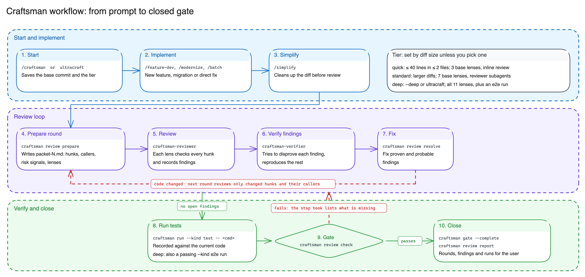
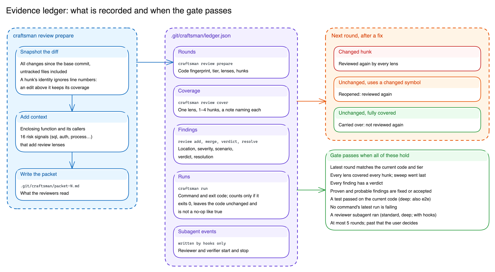
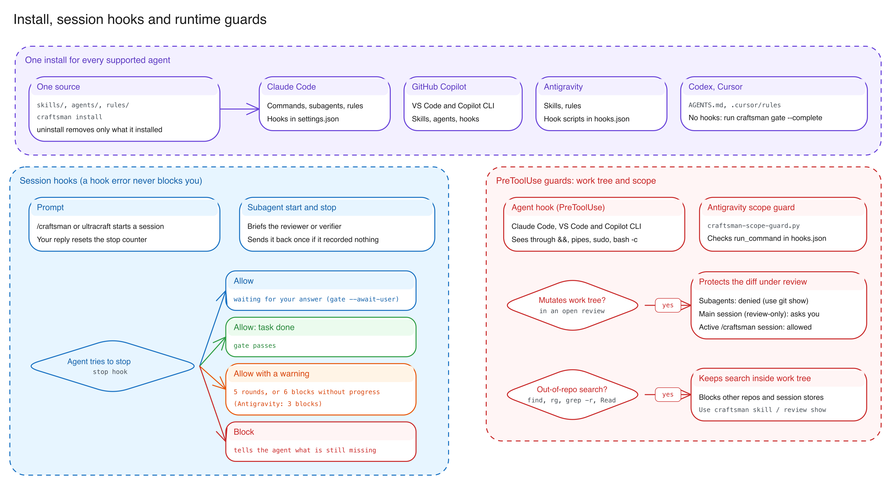
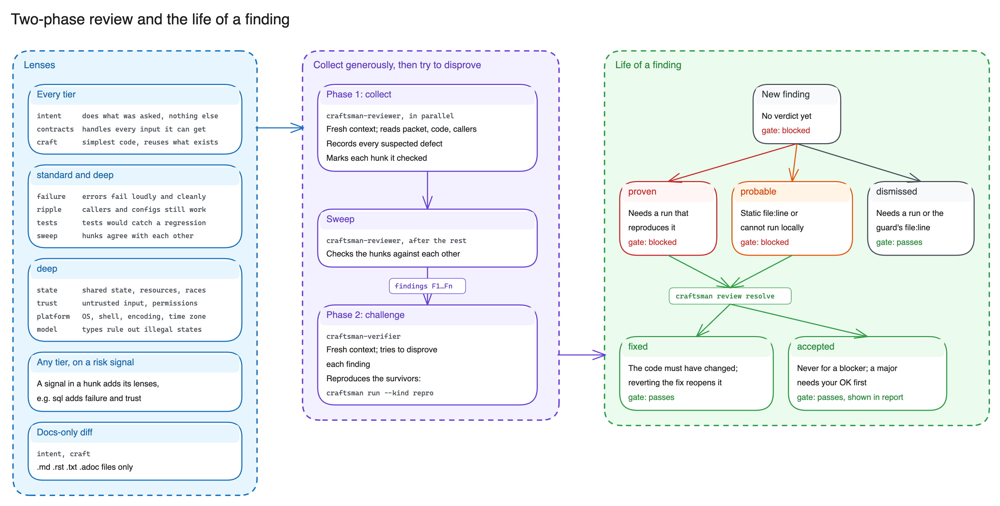

# Craftsman Harness Architecture & Execution Flow

Craftsman is an **adaptive closed-loop engineering harness** for AI coding agents. Rather than relying on prompt-only advice ("remember to review and test your changes"), Craftsman couples **budgeted, context-enriched review packets**, a **two-phase review protocol** (high-recall candidate collection decoupled from adversarial verification), **pinned review scopes**, and a **cryptographically fingerprinted evidence ledger** enforced at runtime by IDE/CLI lifecycle hooks.

This reference documents the end-to-end architecture, state machines, data structures, and invariants of the Craftsman v3.3 harness.

---

## Visual Architecture Suite (Excalidraw)

All diagrams in `docs/diagrams/` are maintained as editable Excalidraw scenes (`.excalidraw`) and rendered to high-DPI PNGs via `@excalidraw/cli`:

```bash
npx @excalidraw/cli render docs/diagrams/<name>.excalidraw \
  --out docs/diagrams/<name>.png --scale 2 --max-width 4096 --max-height 4096
```

| Diagram | Shows | Editable Source | Rendered PNG |
| :--- | :--- | :--- | :--- |
| **1. Workflow** | The ten steps from prompt to closed gate, the review loop, and what each tier changes | [`harness-overview.excalidraw`](diagrams/harness-overview.excalidraw) | [`harness-overview.png`](diagrams/harness-overview.png) |
| **2. Evidence ledger** | What `review prepare` builds, what the ledger records, which hunks the next round re-reviews, and when the gate passes | [`evidence-ledger-flow.excalidraw`](diagrams/evidence-ledger-flow.excalidraw) | [`evidence-ledger-flow.png`](diagrams/evidence-ledger-flow.png) |
| **3. Install, hooks and git guard** | Where `craftsman install` puts things, what each session hook does, the stop hook's outcomes, and the git/worktree rules | [`lifecycle-hooks-and-guards.excalidraw`](diagrams/lifecycle-hooks-and-guards.excalidraw) | [`lifecycle-hooks-and-guards.png`](diagrams/lifecycle-hooks-and-guards.png) |
| **4. Review and verdicts** | Lenses per tier, the two review phases, and the evidence each verdict and resolution needs | [`review-protocol-and-verdicts.excalidraw`](diagrams/review-protocol-and-verdicts.excalidraw) | [`review-protocol-and-verdicts.png`](diagrams/review-protocol-and-verdicts.png) |

---

## 1. End-to-End Closed-Loop Execution & 3-Gear Topology



### Lifecycle Stages

Every `/craftsman` (or `ultracraft`) session progresses through four stages tracked in `.git/craftsman/craftsman_state.json`:

1. **Stage 0 — Baseline Capture & Gate Initialization (`craftsman.gate`)**
   - Triggered automatically by the platform's `UserPromptSubmit` / `userPromptSubmitted` hook when the prompt contains `/craftsman` or `ultracraft`, or explicitly via `craftsman gate --init --tier <auto|quick|standard|deep> --task "<description>"`.
   - Captures `base_sha`: `git rev-parse HEAD` if the repository has commits, or the Git empty-tree SHA (`4b825dc642cb6eb9a060e54bf8d69288fbee4904`) in an unborn repository before its first commit.
   - If an existing `.git/craftsman/ledger.json` belongs to a different `base_sha`, `archive_ledger()` (`craftsman.evidence`) archives it to `ledger-<timestamp>.json`, moves old packets into `archive-<timestamp>/`, and prunes older archives beyond `CRAFTSMAN_KEEP_ARCHIVES` (default `5`).
   - Supports mid-task human clarification via `craftsman gate --await-user` (which pauses the `Stop` hook so the agent can yield its turn and wait for the user's answer) and `craftsman gate --resume`.

2. **Stage 1 — Implementation Track**
   - The orchestrating agent selects the implementation workflow matching the task shape:
     - `/feature-dev`: codebase exploration -> user clarification -> trade-off design -> incremental implementation.
     - `/modernize`: legacy behavior extraction into numbered rule cards -> characterization tests -> behavior-preserving transformation.
     - `/batch`: decomposition of repository-wide migrations into disjoint parallel work units.
     - **Direct implementation**: targeted bug fixes or small enhancements.

3. **Stage 2 — The Quality Loop (`/simplify` -> `/code-review` -> `/verify`)**
   - **Step 2.1 (`/simplify`)**: Runs a behavior-preserving cleanup pass across the cumulative diff (`base_sha..worktree`) to reuse existing helpers, flatten nested control flow, and strip dead code or dishonest comments before any reviewer sees the diff.
   - **Step 2.2 (`craftsman review prepare`)**: Snapshots the worktree (or pinned file scope in review-only mode), computes hunk and diff SHA-256 fingerprints, scans 16 risk signals and mechanical code-quality signals (`S1..Sn`), extracts AST/brace enclosing scopes and cross-repo caller references within bounded character budgets, prunes superseded packet views, and writes `.git/craftsman/packet-N.md`.
   - **Step 2.3 (Lens Passes)**: On `quick`, the active agent applies the selected lenses inline and records multi-lens `--files` coverage. On `standard` and `deep`, fresh-context `craftsman-reviewer` subagents (capped at `--parallel`, default `2`) examine bounded shard or group views (`packet-N.<lenses>.shard-K-of-N.md`), fetch only their assigned playbooks (`craftsman skill show code-review --lenses ...`), and flush candidate findings (`review add`) and multi-lens coverage (`review cover`) incrementally, followed by Wave 2 `sweep`.
   - **Step 2.4 (Adversarial Challenge — conditional on findings)**: Spawned **only when at least one unjudged finding exists**. A fresh-context `craftsman-verifier` subagent inspects `craftsman review show` and `craftsman review show --hunks` (without reading `packet-N.md`), deduplicates same-root-cause findings (`review merge`), attempts to disprove each candidate against the real source tree, executes reproduction scripts (`craftsman run --kind repro -- ...`), and records `proven`, `probable`, `question`, or `dismissed` verdicts (`review verdict`).
   - **Step 2.5 (Fix, Resolve & Delta Re-Review)**: The orchestrator fixes every `proven` and `probable` finding at its root cause, writes regression tests, marks findings resolved (`review resolve`), and opens Round `N+1`. Because the code changed, the diff fingerprint rotates and Round `N+1` re-reviews **only** modified hunks and unchanged hunks that reference a modified symbol.
   - **Step 2.6 (`/verify` — Runtime Verification)**: Once all findings and quality signals are resolved and the current round is 100% covered, the agent runs the project's test suite (`craftsman run --kind test -- ...`) and, on `deep` tier, a real end-to-end execution (`craftsman run --kind e2e -- ...`) at the final diff fingerprint.

4. **Stage 3 — Gate Completion & Reporting**
   - `craftsman review check` (and the platform `Stop` hook) verifies all 13 ledger invariants against the live worktree.
   - `craftsman gate --complete` marks `active = False, stage = "completed"`, and `craftsman review report` emits the final audit report.

---

### The 3-Gear Adaptive Gearbox (`craftsman.gate` & `craftsman.lenses.review_only_tier`)

Craftsman scales review ceremony to the blast radius of the change while guaranteeing that **the effective tier never downgrades** once escalated (`strictest_tier`):

| Gear | Selection Rule | Active Lenses | Subagent Topology & Coverage | Verification |
| :--- | :--- | :--- | :--- | :--- |
| **`quick`** *(Inline Fast-Loop)* | **In `/craftsman`:** explicit `--quick`, or auto-selected for **<= 40 changed lines in <= 2 files** (with no skipped binary/oversized files; or docs-only).<br>**In review-only (`/code-review` without active gate):** default for **<= 250 changed lines** (`REVIEW_ONLY_QUICK_MAX_LINES = 250`) or docs-only diffs; skipped binary/oversized files force `standard`. Diff-size warning threshold is `250` in `--review-only` vs `40` in `/craftsman`. | `intent`, `contracts`, `failure` + `trust` when security signals (`sql`, `deserialization`, `auth`, `process`) fire; `intent`, `craft` for docs-only diffs. **No `sweep` and no `craft` on code diffs.** | **0 subagents** (single agent inline). File-level multi-lens coverage (`review cover --lens intent,contracts,failure --files ...`, 1–4 files/entry, `>= 80` chars/file). | **0 findings:** no verification step.<br>**>= 1 finding:** inline static verification (max `3` `repro` runs in review-only).<br>**In `/craftsman`:** `>= 1` passing `test` or `e2e` run at the final fingerprint. |
| **`standard`** *(Sharded / Hybrid Hard-Loop)* | **In `/craftsman`:** default (`--standard`), or auto-promoted above 40 lines, 2 files, or any skipped file.<br>**In review-only:** auto-selected above **250 changed lines**, when binary/oversized files are skipped, or when a `--fix` delta grows past 250 lines. | `intent`, `contracts`, `failure`, `ripple`, `tests`, `craft`, `design` + **narrower signal-triggered lenses** (`state`: `{concurrency, time}`; `trust`: `{process, sql, deserialization, auth, network, regex}`; `platform`: `{platform, time}`; `model`: `{datamodel}`) + `sweep`. | **`1–2` `craftsman-reviewer` subagents** (`N = 1`: 1 reviewer for all non-`sweep` lenses, or 2 if a single large file exceeds `60k` chars; `N > 1`: `N` file-disjoint shards via `review view --shard K/N`, capped at `--parallel` default `2`). Incremental multi-lens hunk coverage (`"lenses": [...]`, `>= 80` chars/hunk) + file-level `design`. Dedicated `sweep` reviewer in `/craftsman` / `--fix`; in review-only, verifier runs `sweep` when findings exist, or main agent runs `sweep` inline when 0 findings exist. | **`craftsman-verifier` spawned ONLY when `>= 1` finding awaits a verdict** (reads `review show --hunks`, never `packet-N.md`).<br>**In `/craftsman`:** passing `test` run at the final fingerprint + reviewer isolation evidence. |
| **`deep`** *(Full-Audit Hard-Loop)* | Explicit `--deep` / `--tier deep` or prompt keyword `ultracraft` (never auto-selected; mandates a pre-implementation design analysis in `/craftsman`). | **All 12 lenses** (`intent`, `contracts`, `failure`, `ripple`, `state`, `trust`, `tests`, `platform`, `model`, `craft`, `design`, `sweep`). | Sharded `craftsman-reviewer` pool (`N > 1`, `review view --shard K/N`) or fixed `R1`–`R4` reviewer groups (`N = 1`), capped at `--parallel` (default `2`), + Wave 2 `sweep` reviewer. | **`craftsman-verifier` when `>= 1` finding awaits a verdict** + reproduction runs.<br>**In `/craftsman`:** passing `test` run **AND** passing `e2e` run at the final fingerprint. |

---

## 2. Evidence Ledger, Frozen Scope, Packet Budgets & Delta Carry-Over



### Worktree Snapshot, Frozen Review-Only Scope & Two-Level SHA-256 Fingerprinting (`craftsman.diffscan`)

Every ledger check compares the recorded state against a live `DiffSnapshot` generated by `diffscan.snapshot(cwd, base_sha, paths=scope)`:

1. **Tracked + Untracked Capture & Pinned Scope (`Round.scope`)**
   - When `paths is None` (always used when an active `/craftsman` gate session exists, so newly created implementation files automatically enter the review), `snapshot()` scans the entire work tree: `git diff --no-color --no-ext-diff -U3 --find-renames <base_sha>` plus `git ls-files --others --exclude-standard -z` (text files up to `1 MiB` `MAX_UNTRACKED_BYTES`, contentless-change hunks for mode changes, pure renames, binaries, or oversized files, excluding `GENERATED_ARTIFACT_PATTERNS` and `.craftsmanignore`).
   - **Frozen review-only scope (`Round.scope: tuple[str, ...] | None`)**: In standalone review-only mode (no active gate), Round 1 freezes a sorted tuple of concrete POSIX file paths:
     - `--paths a.py,src/b/`: matches changed files against the given files or directory prefixes (failing if any entry matches zero changed files) and freezes the **matched file paths** (never directory wildcards, so a later `src/b/PLAN.md` cannot sneak in).
     - `--staged`: freezes paths from `git diff --cached --name-only --no-renames <base_sha>` (selecting scope from the index while still reading live worktree content; fails if nothing is staged).
     - `--tracked`: freezes tracked files changed against `<base_sha>` (excluding untracked files).
     - *(default, no scope flags)*: freezes all tracked and untracked files changed at Round 1 `prepare` time.
   - **Rename preservation**: Because `git diff --find-renames base -- :(literal)new.py` filters before rename detection and would report `A new.py` instead of `R old.py -> new.py`, the frozen scope always includes both `hunk.path` and `hunk.old_path` for every renamed file.
   - **Why pinned pathspecs instead of `git stash create`**: ODB snapshots skip untracked files and diverge from the live files on disk that reviewers open with `Read`; literal pathspecs (`-- :(literal)<p> ...`) plus untracked path filtering isolate the fingerprint and hunk set while matching disk reads byte-for-byte.
   - **End-to-end scope consistency**: Round `>= 2` inherits `ledger.current_scope` (`ledger.rounds[-1].scope`), allowing monotonic expansion only via `review prepare --add-paths <csv>` (used in `--fix` Step 5 when a fix adds or edits files such as a new regression test; conflicting scope flags fail with a hint to use `--add-paths` or `craftsman review reset`), and `Workspace.snapshot(ledger)` threads `ledger.current_scope` through every `review` command, `hooks`, `status`, and `craftsman run` (so an unrelated `PLAN.md` written by a second agent session never marks the round stale or invalidates a test run's before/after fingerprint). `prepare` prints `Scope: N file(s), frozen for this review.`, lists out-of-scope edits under `Ignored (outside the review scope): ...`, and hints to run `craftsman review reset` when the previous review is already complete.

2. **Level 1: Hunk Digest (`Hunk.digest` — 16-hex SHA-256 prefix) & File Digest (`file_digest`)**
   - Hunk digest:
     ```text
     SHA256(file_path + "\0" + fn_header + "\0" + normalized_diff_lines)[:16]
     ```
   - **Line-number and CRLF invariant**: Hunk start line numbers and trailing `\r` characters are excluded so line shifts elsewhere in the file or `git add` under `core.autocrlf` never invalidate prior coverage.
   - File digest (`file:<16-hex>`): hashes all hunks of a changed file so file-level coverage (`design` on `standard`/`deep`, and every lens on `quick`) automatically invalidates when any hunk in that file changes.

3. **Level 2: DiffSnapshot Fingerprint (`DiffSnapshot.fingerprint` — 64-hex SHA-256)**
   - Computed over all sorted `ChangedFile` entries within the active scope:
     ```text
     SHA256(path + "\0" + status_salt + "\0" + (h.digest:h.new_start:h.new_len for h in hunks))
     ```

---

### Packet Budgets, Progressive Trimming, Shards & On-Demand Playbooks (`craftsman.packet` & `craftsman.playbooks`)

To eliminate multi-hundred-kilobyte prompt blowups while preserving full code context where it matters, Craftsman enforces strict character budgets and on-demand loading:

- **Context Indexing (`WorktreeIndex`) & 16 Risk Signals**:
  - Parses each touched file at most once per round to extract AST/brace enclosing scopes, defined symbols, cross-repository caller locations (`git grep -l -I -w -F -z -e <symbol> --`), mechanical quality signals (`quality.py`: `long-function`, `large-module`, `diff-size`, `test-name`, `duplicate-logic`, `dict-domain`, `parse-error`), and 16 risk signals (`process`, `filesystem`, `network`, `sql`, `deserialization`, `concurrency`, `time`, `regex`, `auth`, `errors`, `datamodel`, `platform`, `config`, `tests`, `deletion`, `docs`).
- **Character Budgets & `quick` Scope Pointers**:
  - `MAX_PACKET_CHARS = 120_000` for `standard` and `deep` packets.
  - `MAX_QUICK_PACKET_CHARS = 40_000` for `quick` packets; `quick` packets omit inlined enclosing scope bodies by default, printing `Scope: <name> (<kind>, L<start>–L<end>)` pointers so the single inline agent reads source files directly.
  - `MAX_VIEW_CHARS = 60_000` for per-reviewer shard views.
- **Progressive Budget-Trimming Ladder**:
  When a packet or shard view exceeds its budget, `packet.py` trims in three deterministic stages, stopping as soon as the output fits and **never dropping a hunk header silently**:
  1. Remove inlined enclosing scope bodies starting from the largest scope;
  2. Cap caller references from `8` down to `3` per symbol, appending `(+K more: git grep -n <symbol>)`;
  3. Replace the largest hunk diff bodies with `diff omitted (N lines): git diff <base7> -- <path>` and list all omitted IDs in an explicit `## Omitted hunk bodies` section while keeping every hunk's header (ID, file, line range, signals).
- **Deterministic File-Disjoint Shards (`craftsman review view --shard K/N`)**:
  - `review prepare` prints `Suggested reviewer shards: N` on `standard`/`deep`, where `N = min(4, max(1, open_file_count), ceil(packet_chars / MAX_VIEW_CHARS))` (`1 (no sharding needed)` when `N = 1`).
  - `review view --shard K/N --lenses <lenses>` partitions open hunks into `N` shards (`1 <= K <= N <= open_file_count`) without ever splitting a file across shards, greedily balancing rendered size (largest file into lightest shard, ties broken by path) into `packet-<n>.<lenses>.shard-K-of-N.md` with `Files in this shard: a.py, b.py` in the header.
- **On-Demand Per-Lens Playbooks (`craftsman skill show code-review --lenses <csv>`)**:
  - Neither `agents/craftsman-reviewer.md` nor single-file command exports (`~/.claude/commands/code-review.md`) inline `skills/code-review/lenses.md` (`22.8 KB`). Instead, `playbooks.lens_playbooks()` slices `lenses.md` on `## \`<id>\` — ...` headings and prints the shared preamble once plus only the requested lenses or `R1`–`R4` groups in catalog order.
- **`.git/craftsman` State Hygiene (`craftsman.evidence`)**:
  - Preparing round `N` runs `prune_round_files()`, deleting old `packet-<k>.*.md` views for `k < N` and old `packet-<k>.md` packets for `k < N - 1` (`Pruned: <name>`).
  - Archiving ledgers (`review reset`, gate init rebase/new-base archival, hooks) retains the newest `CRAFTSMAN_KEEP_ARCHIVES` (default `5`, integer `>= 1`) `archive-*` directories and `ledger-*.json` files.

---

### Evidence Ledger Schema v2 & Atomic Persistence (`craftsman.records` & `craftsman.ledger`)

All verification state resides in `.git/craftsman/ledger.json` (`SCHEMA_VERSION = 2`). Under Craftsman's no-legacy policy, a schema `1` ledger raises a `LedgerError` instructing the user or agent to run `craftsman review reset` to archive it (schemas `> 2` instruct upgrading Craftsman). Concurrent writes from parallel subagents are serialized via `ledger.mutate(path, fn)` using an exclusive OS lock (`ledger.lock`) and atomic `tempfile.mkstemp` + `os.replace()`.

The ledger stores immutable tuple collections:

1. **`rounds: tuple[Round, ...]`** — Records `number`, `fingerprint`, `base_sha`, `tier`, `prepared_at`, `lenses`, `hunks: tuple[HunkRef, ...]`, `signals: tuple[QualitySignal, ...]`, `packet_path`, and `scope: tuple[str, ...] | None`.
2. **`coverage: tuple[Coverage, ...]`** — Written by `craftsman review cover --lens <L1,L2,...> (--hunks H1,H2 | --files a.py,b.py) --note "..."` (or `--from-json` with `"lens"` or `"lenses": [...]`):
   - **Multi-lens expansion**: One CLI/JSON entry with `K` lenses validates targets and note rules once in `ledger.py` and atomically writes `K` `Coverage` records. `sweep` cannot be combined with other lenses, and hunk targets cannot be mixed with file targets.
   - **Target granularity**: Up to `4` targets per entry (`MAX_HUNKS_PER_COVERAGE = 4`). In `quick` rounds, every lens accepts either `--files` (`file_digest`) or `--hunks` (`hunk.digest`); in `standard`/`deep`, `--files` is restricted to `design`.
   - **Concrete note validation**: Every target (`H#`, or full path / unique round basename for `--files`) requires its own concrete code-detail segment of `>= 40` characters (`MIN_HUNK_NOTE_SEGMENT_CHARS = 40`) for a single-lens entry and a constant **`>= 80` characters (`2 * MIN_HUNK_NOTE_SEGMENT_CHARS`) whenever `>= 2` lenses are combined**, rejecting generic praise (`looks good`, `lgtm`, `clean`, …) and verbatim reuse across `> 3` targets.
3. **`findings: tuple[Finding, ...]`**, **`facts: tuple[Fact, ...]`**, **`signal_acks: tuple[SignalAck, ...]`** — Candidate defects (`F1..Fn`, optionally linked to `--signal S#`), source-cited shared facts (`F-1..F-n`), and concrete `>= 40`-char acknowledgements of mechanical quality signals (`review ack S# --reason "..."`).
4. **`runs: tuple[Run, ...]`** & **`waivers: tuple[RunWaiver, ...]`** — Recorded executions (`craftsman run --kind <test|e2e|repro|lint|build|other> -- <cmd>`) using the ledger's pinned `scope` for before/after fingerprinting, plus explicit run waivers (`review waive-run`).
5. **`agents: tuple[AgentEvent, ...]`** — Written exclusively by platform `SubagentStart` / `SubagentStop` hooks.

---

### Delta Carry-Over & Transitive Symbol Reopening (`ledger._carry_over`)

When Round `N+1` is prepared after fixes:
1. **Changed Hunks**: Hunks with a new 16-hex `digest` start open (`carried = False`) and seed modified symbols $S_0 = \bigcup \text{defined\_symbols}(h)$.
2. **Transitive Symbol Propagation**: Unchanged hunks mentioning any $s \in S$ are marked **reopened** (`carried = False, reopened = True`) and contribute their `defined_symbols` to $S$ until fixed point.
3. **File & Hunk Carry-Over**: Unchanged, non-reopened hunks covered by all selected lenses in earlier rounds (via either hunk digest or, in `quick` rounds / `design`, unchanged file digest) carry over (`carried = True`) and are skipped.

---

### The 13 Gate Issue Codes (`craftsman.gatecheck.evaluate`) & Partial Reports

`gatecheck.evaluate(led, snap, policy, *, review_only=False)` returns a `GateReport`. The gate passes (`report.passed == True`) when `issues == ()` (`PASSED` in `/craftsman`, or `COMPLETE (review-only)` in `--review-only` mode). When a subagent fails after one sequential retry on rate limits, quota, or timeout in review-only mode, `craftsman review report --review-only --partial` exits `0` with `PARTIAL (review-only, N open items)`, adding a `## Not covered` section (`lens -> uncovered H#/files`) and marking unjudged findings `(unverified)`:

| # | Issue Code | Condition Triggering Failure | Exact CLI Remediation |
| :---: | :--- | :--- | :--- |
| 1 | `no-round` | `ledger.rounds` is empty | `craftsman review prepare` |
| 2 | `stale-round` | Latest round's `fingerprint != snap.fingerprint` or `base_sha != snap.base_sha` (within `Round.scope`) | `craftsman review prepare` |
| 3 | `tier-too-low` | Latest round's `tier` rank is lower than `GatePolicy.tier` | `craftsman review prepare` |
| 4 | `uncovered` | Any selected `lens` lacks coverage for open hunks/files (grouped into multi-lens `--lens a,b,c` hints, using `--files` on `quick`) | `craftsman review cover --lens <lenses> ...` |
| 5 | `sweep-too-early` | `sweep` coverage timestamp precedes another lens's latest coverage timestamp | Re-run `craftsman review cover --lens sweep ...` last |
| 6 | `unresolved-signal` | A mechanical quality signal `S#` has neither an acknowledged `SignalAck` nor a linked finding | `craftsman review ack S# --reason '...'` or `review add --signal S# ...` |
| 7 | `no-verdict` | Any finding `F#` has `verdict is None` | Spawn `craftsman-verifier` -> `craftsman review verdict ...` |
| 8 | `unresolved` | A `proven`/`probable` finding has `resolution is None`, or `fixed` without changing the diff fingerprint | Fix code, `craftsman review resolve F# --as fixed ...`, `review prepare` |
| 9 | `no-passing-run` | No non-trivial passing `test` or `e2e` run at `snap.fingerprint` | `craftsman run --kind test -- <test-command>` |
| 10 | `no-e2e-run` | `GatePolicy.tier == "deep"` and no passing `e2e` run at `snap.fingerprint` | `craftsman run --kind e2e -- <real-command>` |
| 11 | `failing-run` | Most recent run of a command in the same `cwd` exited non-zero and was not waived | Fix and re-run, or `craftsman review waive-run R# --reason '...'` |
| 12 | `no-isolation` | `GatePolicy.require_isolation` is `True` and no `craftsman-reviewer` completion evidence exists for the round | Delegate lens review to `craftsman-reviewer` |
| 13 | `round-cap` | `> 5` distinct diff fingerprints reviewed (`MAX_ROUNDS = 5`) | Stop automated loop and escalate to the user (`needs_human`) |

---

## 3. Multi-Platform Lifecycle Hooks, Stop Gate & Defense-in-Depth Git / Worktree Guards



### Single-Source Multi-Platform Exporter & Installer (`craftsman.export` & `craftsman.install`)

Craftsman authors skills (`skills/<name>/SKILL.md`), lens playbooks (`skills/code-review/lenses.md`), subagent templates (`agents/craftsman*.md`), and global rules (`rules/*.md`) once, expanding `{{include path}}` directives into native artifacts tracked by `.craftsman-install.json`:

1. **GitHub Copilot (VS Code & Copilot CLI)** — Global instructions (`craftsman-rules.instructions.md`), Agent Skills (`~/.copilot/skills/<skill>/`), custom agents (`~/.copilot/agents/*.agent.md`), and lifecycle hooks (`~/.copilot/hooks/craftsman.json` or `.github/hooks/craftsman.json`).
2. **Claude Code (`~/.claude`)** — Slash commands (`~/.claude/commands/<skill>.md` — `code-review.md` stays lean without inlining `lenses.md`), subagents (`~/.claude/agents/craftsman-{reviewer,verifier}.md`), combined rules, and `CLAUDE_HOOK_EVENTS` merged into `~/.claude/settings.json`.
3. **Google Antigravity (`~/.gemini/config`)** — Skills, rules, hook scripts (`scripts/git-guard.py`, `scripts/craftsman-stop-gate.py`), and `hooks.json`, plus transcript verification (`transcript.jsonl`) for `invoke_subagent` reviewer isolation.
4. **OpenAI Codex, Cursor & Team Repositories** — Managed `<!-- craftsman:begin --> ... <!-- craftsman:end -->` block in `AGENTS.md` and `.cursor/rules/craftsman.mdc`, gated via `craftsman gate --complete`.

---

### Lifecycle Hook Engine & Bounded Stop Gate (`craftsman.hooks` & `craftsman.gate`)

- **`prompt` (`UserPromptSubmit` / `userPromptSubmitted`)**: Resumes `--await-user` gates on user reply and initializes `craftsman_state.json` on `/craftsman` or `ultracraft`.
- **`subagent-start` / `subagent-stop`**: Records `AgentEvent` entries in `ledger.json`, injects concise round/finding briefings (using `latest.scope` for snapshot checks), and blocks once if a reviewer or verifier exits without recording ledger entries.
- **`stop` (`Stop` / `agentStop`)**: Enforces monotonic progress across up to `MAX_FORCED_CONTINUATIONS = 6` consecutive non-progressing turns and `MAX_ROUNDS = 5` delta rounds.

---

### Defense-in-Depth Git, Worktree-Mutation & Search-Scope Guards (`craftsman.guard`, `craftsman.scope`, `git-hooks/`)

Craftsman enforces repository safety through `craftsman hook pre-tool` (and OS-level global Git hooks `pre-push` / `commit-msg` for rules 1 and 2):

1. **Shell Command Parser & Wrapper Unwrapper (`guard.iter_simple_commands` & `parse_git_invocation`)**
   - Unwraps `;`, `|`, `&&`, `||`, subshells, heredocs, `env`, `sudo`, `timeout`, `xargs`, `find -exec`, nested `sh`/`bash`/`zsh -c`, `git -C <dir>`, and inline `-c alias.x=...` definitions.

2. **Global Rule #1: No Unconfirmed Push to `main` / `master`** (`analyze_git_push`, `analyze_gh_pr_merge`) — Prompts (`ask`) or blocks unconfirmed pushes and PR merges targeting `main`/`master`.

3. **Global Rule #2: Zero AI Attribution** (`has_ai_attribution`) — Rejects commits, tags, and PRs carrying AI attribution trailers (`Co-authored-by:`, `Generated by/with`, etc.).

4. **Worktree & Index Mutation Guard During Review (`guard.find_worktree_mutation` in `hooks.on_pre_tool`)**
   - Intercepts Git commands that mutate the work tree or index:
     - `git stash` via a strict **allowlist**: only `stash list`, `stash show`, and `stash create` are permitted; bare `git stash` and flag/path forms (`git stash -u`, `-p`, `-m`, `-- a.py`) are blocked;
     - `reset`, `checkout`, `switch`, `restore`, `clean` (all forms);
     - additionally when `subagent=True`: `commit`, `merge`, `rebase`, `cherry-pick`, `revert`, `am`, `apply`, `pull`, `rm`, `mv` (read-only commands such as `status`, `diff`, `show`, `log`, `grep`, `ls-files`, `blame`, and `rev-parse` are always allowed).
   - **Role-sensitive enforcement in `on_pre_tool`**:
     - **Reviewer and verifier subagents** (`agent_role(hook.agent) is not None`, excluding the main `@craftsman` orchestrator): immediately **denied** (`reply.deny`) with instructions to use `git show <base>:<path>` and a temp directory.
     - **Main session (including `@craftsman` orchestrator) during an active review-only round** (`_review_in_progress`: no active `/craftsman` gate, latest round prepared within the last 12 hours, and uncovered lenses or unjudged findings remain): **prompts the user for confirmation** (`reply.ask`).
     - **Active `/craftsman` gate or no open review**: **allowed**, so normal implementation (`git commit`, `checkout -b`, `mv`, `rm`) proceeds unimpeded.
   - **Platform limitations**: This runtime guard operates only on platforms that fire `PreToolUse` hooks (**Claude Code**, **VS Code Copilot**, and **Copilot CLI**). On platforms without `PreToolUse` hooks (such as **OpenAI Codex** or **`agy -p`**), the prohibition in the skill prompt is the only protection. If a platform does not pass the subagent's agent identifier in the hook payload, the subagent call falls back to the main-session `ask` rule. Direct `Edit`/`Write` file tools are already excluded from the `craftsman-reviewer` and `craftsman-verifier` tool definitions.

5. **Repository Search-Scope Guard (`craftsman.scope`)**
   - Blocks recursive directory searches (`find`, `rg`, `grep -r`, `fd`, `Glob`, `Grep`, `LS`, etc.) outside the active git work tree and blocks reading other repositories, shell history, or assistant session stores, directing skill/playbook and packet lookups to `craftsman skill show` and `craftsman review show`.

---

## 4. Two-Phase Code Review Protocol, Lens Matrix & Verdict Lifecycle



### Phase 1 (Collection) vs. Phase 2 (Conditional Adversarial Verification)

1. **Phase 1 — High-Recall Candidate Collection (`quick` inline or `craftsman-reviewer`)**
   - **Quick path (review-only default `<= 250` lines; `/craftsman` `<= 40` lines in `<= 2` files)**: Single agent inline, `0` subagents. Fetches playbooks via `craftsman skill show code-review --lenses <round-lenses>`, reads enclosing functions directly in source files, records findings (`review add`), closes mechanical signals (`S#`), and writes a single multi-lens `--files` coverage entry per 1–4 files (`review cover --lens intent,contracts,failure --files ...`). No `sweep` pass runs on `quick`.
   - **Standard & Deep path (`craftsman-reviewer` shards or groups, capped at `--parallel` default `2`)**: Each reviewer reads only its bounded shard or group view (`<= 60k` chars), loads only its assigned playbooks (`craftsman skill show code-review --lenses ...`), and flushes findings and multi-lens hunk coverage (`"lenses": [...]`, `>= 80` chars/hunk; `"design"` separately on `"files"`) incrementally after every 1–4 hunks or 2–3 lenses. If a subagent fails on rate limit, quota, or timeout, the orchestrator retries **at most once sequentially** and then either emits `craftsman review report --review-only --partial` (in review-only) or pauses via `craftsman gate --await-user` (in `/craftsman`).
   - **Cross-Hunk `sweep`**: In `/craftsman` and `/code-review --fix`, a dedicated Wave 2 `craftsman-reviewer` runs `sweep`. In review-only `standard`/`deep`, if `>= 1` finding exists, `craftsman-verifier` runs `sweep` in Step 0; if `0` findings exist, the main agent runs `sweep` inline using `craftsman review show --hunks` + `git diff <base> --stat` + targeted `git diff <base> -- <file>` (with `>= 40` chars of concrete code detail per `H#`), spawning no verifier.

2. **Phase 2 — Adversarial Challenge & Reproduction (`craftsman-verifier`, only when unjudged findings exist)**
   - Spawned **only when `>= 1` finding has `verdict is None`**.
   - Never reads `packet-N.md`: uses `craftsman review show` and `craftsman review show --hunks` (`H# -> path:start-end`), groups unjudged same-root-cause duplicates (`review merge`, only when one fix removes every consequence), and tries to disprove each finding (guard check, reachability check, PR intent `--as question`, semantics check).
   - In review-only mode, verifies statically by default (`static: <file:line chain>`) with a cap of `3` `craftsman run --kind repro` runs across the review; with `--fix` or inside `/craftsman`, attempts runtime reproduction in a temp directory for all importable code.

---

### Verdict & Resolution State Machine

| Transition | Command | Evidence Enforced by CLI / Ledger | Gate Outcome |
| :--- | :--- | :--- | :--- |
| **Created** (`verdict = None`) | `craftsman review add ...` (`review merge` folds unjudged same-root-cause duplicates) | Must reference a selected round lens; echoes cited source line | **BLOCKED** (`[no-verdict]`) |
| **Verdict: `proven`** | `craftsman review verdict F# --as proven --run R# --evidence "..."` | Requires `--run R#` pointing to a real non-trivial `Run` and `--evidence` (`>= 20` chars) | **BLOCKED** (`[unresolved]`) until fixed or accepted (warning in `--review-only`) |
| **Verdict: `probable`** | `craftsman review verdict F# --as probable --evidence "static: <file:line chain>"` or `"no-repro: <why>; <chain>"` | `--evidence` must start with `static:` (citing `file:line`) or `no-repro:` (`>= 20` chars after prefix) | **BLOCKED** (`[unresolved]`) until fixed or accepted (warning in `--review-only`) |
| **Verdict: `question`** | `craftsman review verdict F# --as question --evidence "intent: <source>; <file:line>"` | **Forbidden** when `severity == "blocker"`. Requires `intent:` prefix (`>= 20` chars) citing intent source and `file:line` | **PASS** (listed under *Question* in report) |
| **Verdict: `dismissed`** | `craftsman review verdict F# --as dismissed [--run R#] --evidence "..."` | Requires `--run R#` or concrete `file:line` guard reference in `--evidence` | **PASS** (listed briefly under *Dismissed*) |
| **Resolution: `fixed`** | `craftsman review resolve F# --as fixed --note "..."` | Requires `verdict in ("proven", "probable")`, `--note` (`>= 20` chars), and rotated diff fingerprint | **PASS** (opens delta Round `N+1`) |
| **Resolution: `accepted`** | `craftsman review resolve F# --as accepted --note "..."` | **Forbidden** when `severity == "blocker"`; `major` requires user approval (`gate --await-user`) | **PASS** (with audit warning) |

---

## 5. Module Map & Source Cross-Reference

| Module | Responsibility | Key Entrypoints & Types |
| :--- | :--- | :--- |
| [`craftsman/cli.py`](../craftsman/cli.py) | Unified CLI dispatcher (`craftsman <subcommand>`, `skill show --lenses`, scope-aware `status`) | `main()`, `build_parser()` |
| [`craftsman/gate.py`](../craftsman/gate.py) | Session state machine (`.git/craftsman/craftsman_state.json`), 3-Gear auto-promotion, and stop-hook evaluation | `task_tier()`, `evaluate_task()`, `evaluate_stop()`, `run_cli()` |
| [`craftsman/evidence.py`](../craftsman/evidence.py) | Ledger archival, packet/view pruning (`prune_round_files`), and `CRAFTSMAN_KEEP_ARCHIVES` retention | `archive_ledger()`, `prune_round_files()`, `packet_path()` |
| [`craftsman/records.py`](../craftsman/records.py) | Typed ledger records (`SCHEMA_VERSION = 2`, `Round.scope`, `Coverage`, `Finding`, `QualitySignal`, `Run`) | `Ledger`, `Round`, `Coverage`, `Finding`, `FieldError`, `LedgerError` |
| [`craftsman/ledger.py`](../craftsman/ledger.py) | OS file locking, atomic persistence, multi-lens/file-level coverage validation, and delta carry-over | `mutate()`, `open_round()`, `add_coverage()`, `uncovered_by_lens()`, `_carry_over()` |
| [`craftsman/gatecheck.py`](../craftsman/gatecheck.py) | 13-check gate evaluator, multi-lens coverage hints, `review_only` warnings, and partial report labels | `evaluate()`, `GateReport`, `GatePolicy`, `render_report()` |
| [`craftsman/diffscan.py`](../craftsman/diffscan.py) | Scoped git diff + untracked scanner (literal pathspecs), `WorktreeIndex`, and two-level SHA-256 fingerprinting | `snapshot()`, `DiffSnapshot`, `ChangedFile`, `Hunk`, `WorktreeIndex`, `detect_signals()` |
| [`craftsman/packet.py`](../craftsman/packet.py) | Budgeted packet renderer (`120k` / `quick 40k`), 3-step progressive trimming ladder, and `60k` deterministic shards | `collect_context()`, `render_packet()`, `render_shard_view()`, `MAX_PACKET_CHARS`, `MAX_QUICK_PACKET_CHARS`, `MAX_VIEW_CHARS` |
| [`craftsman/lenses.py`](../craftsman/lenses.py) | Leaf catalog of 12 review lenses, `REVIEWER_GROUPS`, `review_only_tier()` (`250`-line threshold), and signal triggers | `LENSES`, `REVIEWER_GROUPS`, `select_lenses()`, `review_only_tier()` |
| [`craftsman/playbooks.py`](../craftsman/playbooks.py) | On-demand slicer for `skills/code-review/lenses.md` by lens IDs and `R1`–`R4` groups | `lens_playbooks()` |
| [`craftsman/quality.py`](../craftsman/quality.py) | AST/diff mechanical code-quality signal detectors (`S1..Sn`) | `scan_quality_signals()` |
| [`craftsman/review.py`](../craftsman/review.py) | CLI handlers for `prepare` (`--staged`/`--tracked`/`--paths`/`--add-paths`), `view` (`--shard`), `cover` (multi-lens), `show` (`--hunks`), `report` (`--partial`), `add`, `ack`, `fact`, `merge`, `verdict`, `resolve`, `check`, `reset` | `run_cli()`, `resolve_tier()` |
| [`craftsman/runner.py`](../craftsman/runner.py) | Live-streaming command execution wrapper (`craftsman run`) with scope-consistent before/after fingerprinting | `run_cli()` |
| [`craftsman/hooks.py`](../craftsman/hooks.py) | Multi-platform lifecycle hook adapter (`prompt`, `stop`, `subagent-start`, `subagent-stop`, `pre-tool` worktree guard) | `run_cli()`, `on_pre_tool()`, `_review_in_progress()` |
| [`craftsman/guard.py`](../craftsman/guard.py) | Shell parser, protected-branch push guard, AI attribution blocker, and worktree/index mutation detector | `find_worktree_mutation()`, `analyze_git_push()`, `has_ai_attribution()` |
| [`craftsman/export.py`](../craftsman/export.py) | Multi-platform skill/agent/hook compiler | `export_to_copilot_skills()`, `export_copilot_home()`, `export_to_claude_user()`, `export_to_agents_workspace()` |
| [`craftsman/doctor.py`](../craftsman/doctor.py) | Repository asset validator and cross-platform installation health/drift/duplicate checker | `build_report()`, `validate_skill_manifests()` |
| [`craftsman/install.py`](../craftsman/install.py) | Cross-platform installer and uninstaller with `.craftsman-install.json` manifest tracking | `run_install_cli()`, `run_uninstall_cli()` |
