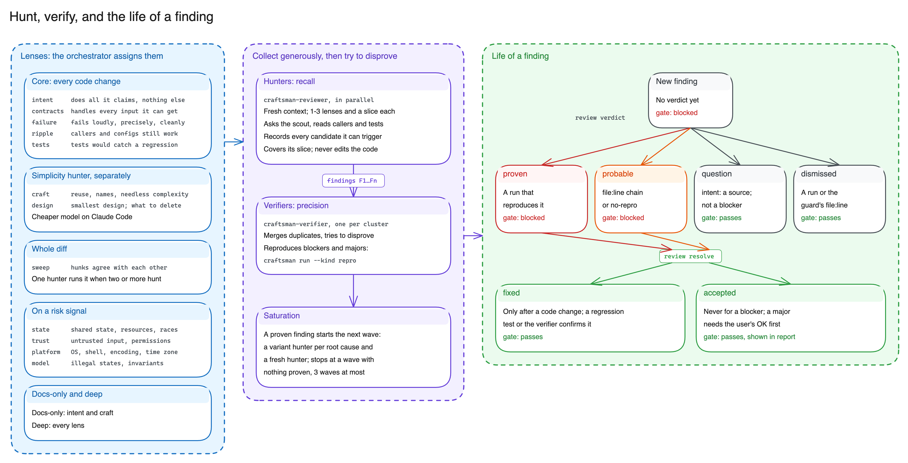
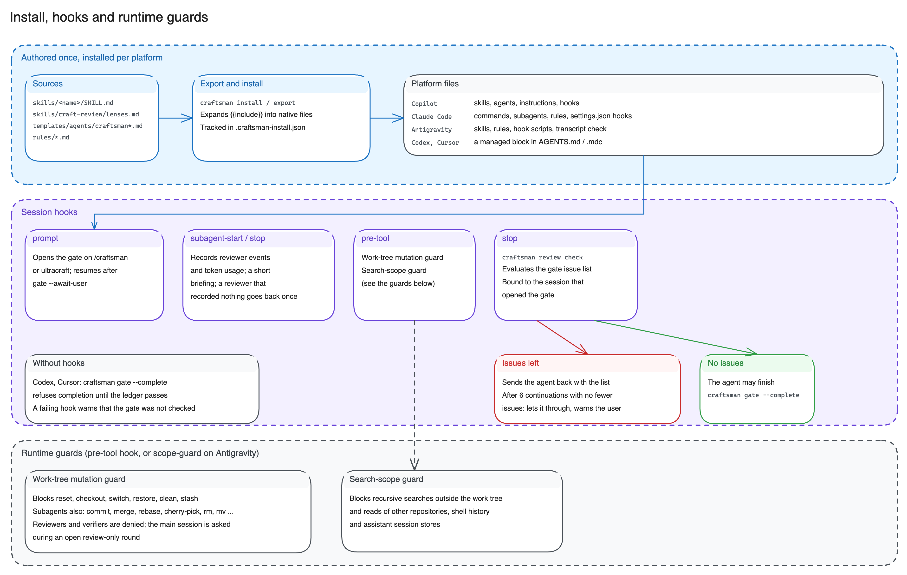

# How Craftsman Works

Craftsman is built on one idea: **build freely, review hard**. The agent implements without review
loops or ledger bookkeeping. When it finishes, the final diff is frozen and attacked by fresh-context
hunters; every finding is judged with evidence; the tests run on the final code. The gate checks
outcomes on that final diff, not the effort that led there.

```
/craftsman <task>          prompt hook (or `craftsman gate --init`) records the base commit
        │
        ▼
   build freely            no gate activity; tests and tools as needed; end with /simplify
        │
        ▼
craftsman review prepare   freezes the diff into round N: packet-N.md and a risk map
        │
        ▼
   intent brief            3-8 claims about what the change must do, each with the line that makes it true
        │
        ▼
   hunt plan + wave 1      craftsman-reviewer hunters in parallel, fresh context, record candidates
        │
        ▼
   verify                  craftsman-verifier subagents try to disprove and reproduce:
        │                  proven / probable / question / dismissed
        ▼
   saturate                confirmed defects in wave k? run wave k+1 (max 3 per round)
        │
        ▼
   fix + resolve  ──►  next round covers only the changed hunks
        │
        ▼
craftsman run --kind test|e2e -- …   runs recorded with exit codes
        │
        ▼
craftsman review check  →  stop hook lets the agent finish  →  craftsman review report
```

---

## The Protocol

1. **Gate.** `craftsman gate --init [--deep] --task "<one line>"` records the base commit. The prompt
   hook runs it on platforms that have hooks.
2. **Build.** No ledger entries, no review. The agent asks you only when an ambiguity changes what
   gets built (`gate --await-user`, then `gate --resume`).
3. **Freeze.** `review prepare` computes the diff since the base into round N and prints the packet
   path and the **risk map**: files, hunks, changed lines, risk signals with the lenses they suggest,
   quality hints, and warnings such as a very large diff.
4. **Intent brief.** The orchestrator lists what the change must do, each claim tied to a line. A
   claim without a line is already a finding.
5. **Hunt plan and wave 1.** The orchestrator decides the hunters and launches them together, each
   as a fresh-context `craftsman-reviewer` subagent. Guidance, which the CLI does not enforce:
   - every code change gets `intent`, `contracts`, `failure`, `ripple`, `tests`, plus every lens
     the risk map suggests or the orchestrator's own reading calls for. Risk signals are pattern
     matches for a few languages: a floor, not a verdict. Deep assigns every lens;
   - `craft` and `design` go to a separate simplicity hunter so they never take attention from bug
     hunting;
   - 1-3 lenses per hunter, and large changes split by files (roughly 400 changed lines per hunter);
   - with two or more hunters, one also runs `sweep` over the whole diff;
   - a tiny change may get one hunter with all core lenses.
6. **Verify.** When findings exist, `craftsman-verifier` subagents run in parallel, one per cluster
   of related findings. They merge duplicates, try to disprove each finding, reproduce it where the
   code is runnable, and record a verdict.
7. **Saturate.** If wave k produced a finding judged `proven` or `probable`, wave k+1 runs: one
   variant hunter per confirmed root cause (the same mistake elsewhere in the diff and the code it
   touches) plus one fresh hunter with a different partition or unused lenses, told nothing about
   earlier findings. The hunt stops at the first wave that adds nothing confirmed, or after 3 waves
   per round. Deep always runs at least 2.
8. **Fix.** Every `proven` or `probable` finding is fixed at the root cause with a regression test
   where the project has tests, then `review resolve`. `review prepare` opens a new round holding
   only the changed hunks plus hunks that reference a changed symbol; one fresh hunter re-checks
   them, with a verifier if it records findings. The round cap bounds this loop.
9. **Test.** `craftsman run --kind test -- <cmd>` on the final code; deep also `--kind e2e`.
10. **Close.** `craftsman review check`, then `craftsman gate --complete`, then `craftsman review
    report`.

A subagent that fails (rate limit, timeout) is retried once with a smaller slice. If subagents keep
failing, the agent runs `gate --await-user` and tells you what is not covered; in review-only mode
the report is `--partial`.

### `/code-review`

The same hunt (steps 3-7) against a base, with a frozen scope, and no fixes unless asked. It ends
with `review check --review-only` and `review report --review-only`. Fixing adds steps 8-9.
Every review uses at least one fresh-context hunter where the platform has subagents.

### Adaptive depth

There is one depth, `deep`, and the orchestrator decides when to use it: security-relevant code,
concurrency or clocks, persistent data or migrations, public API or file formats, removed
guarantees, a large or cross-cutting diff, or a user who asks for care. It escalates with `review
prepare --deep`; `prepare` may print a hint such as `Depth: deep suggested (signals: auth H3,
concurrency H7)`. Deep suggests every lens, requires at least two waves by convention, and makes the
gate require an e2e run. Inside a gate session, `--deep` raises the gate for good. Depth never goes
down.

---

## Evidence Ledger


Everything goes into `.git/craftsman/ledger.json`, stored separately for each worktree and outside
commits (schema 3).

| Record | Written by | Gate requirement |
| :--- | :--- | :--- |
| **Round**: diff fingerprint, hunks with digests, scope, `deep` flag | `review prepare` | The latest round matches the current code |
| **Coverage**: hunk digests and a one-line note (at least 20 characters) on what a hunter examined and tried | `review cover` (or `--from-json`) | Every hunk of the round is covered, in this round or an earlier one |
| **Finding**: location, lens, severity, scenario | `review add` (or `--from-json`); `review move` fixes a line; `review merge` merges duplicates with a shared root cause | Every finding has a verdict |
| **Verdict**: `proven` (reproduction `--run R#`), `probable` (`static: <file:line chain>` or `no-repro: <why>; <chain>`), `question` (`intent: <source>; <file:line>`, non-blocking findings only), `dismissed` (run or `file:line`) | `review verdict` (or `--from-json`) | `proven` and `probable` findings are resolved. In review-only mode they go into the report as warnings |
| **Resolution**: `fixed` (only after a code change) or `accepted` (never for blockers) | `review resolve` | All blocking findings are resolved |
| **Run**: argv, working directory, exit code, output tail, diff fingerprint | `craftsman run` | A passing test run (and e2e when deep) on the final code that did not modify files. The last run of every command succeeds unless retired with `review waive-run` and a visible reason |
| **Agent event**: reviewer subagent start and stop | platform hooks | An independent reviewer finished after the round was prepared |

Every record is tied to a diff fingerprint, so a code change invalidates old evidence. A hunk stays
covered across rounds by its digest, which ignores line numbers and CRLF, so the next round re-reviews
only changed hunks and hunks that reference a changed symbol. Generated files (`__pycache__`, build
caches, `node_modules`, ...) are skipped; custom patterns go in `.craftsmanignore`.

---

## What the Gate Checks and What It Does Not

The gate reports an issue list. It passes when the list is empty:

| Issue | Meaning |
| :--- | :--- |
| `no-round`, `stale-round` | No review round, or the code changed since the last one |
| `uncovered` | Open hunks no hunter has covered |
| `no-verdict` | A finding has no verdict |
| `unresolved` | A `proven` or `probable` finding is neither fixed nor accepted |
| `no-passing-run` | No passing test run on the final code |
| `no-e2e-run` | Deep only: no passing e2e run |
| `failing-run` | The latest run of a command failed and was not waived |
| `no-isolation` | The platform gives isolation evidence, but no `craftsman-reviewer` finished after the latest round was prepared |
| `round-cap` | More than 5 distinct diffs were reviewed: the agent stops and the user decides |

The gate **does not** assess business-requirement fit, naming quality, or architecture outside the
files touched by the diff. Every report lists these under `Not assessed by the gate`. It also does not
judge how hard the hunters looked: it checks that fresh hunters covered every hunk of the frozen diff
and that every finding has checkable evidence. A very large diff produces a warning in `prepare` and
in the report; it no longer hands off to the user. Without platform or transcript isolation evidence,
the report carries a `SELF-REVIEWED` banner.

---

## Review Lenses



A lens is a focused review angle with specific probes. `review prepare` suggests lenses from the
risk signals in the diff; the orchestrator assigns them to hunters.

| Lens | What it looks for | Suggested |
| :--- | :--- | :--- |
| `intent` | Missing pieces, incomplete change propagation, unrequested changes, fixes in the wrong layer | Every change |
| `contracts` | Input domains, boundary conditions, truthiness, wrong variable, inconsistent return values | Every code change |
| `failure` | Swallowed errors, partial side effects, retries, fail-open guards | Every code change |
| `ripple` | Broken callers, removed guarantees, overridden methods, persisted data compatibility | Every code change |
| `tests` | Tests that would pass even if the change were wrong | Every code change |
| `craft` | Code reuse, needless complexity, misleading names and comments, wasted work | Always (simplicity hunter) |
| `design` | Overall design and size of the change, what can be deleted | Always (simplicity hunter) |
| `state` | Aliasing, caches, check-then-act races, `async` bugs, clocks | Concurrency, time, and filesystem signals |
| `trust` | Untrusted data in shells, SQL, paths, deserializers; authorization | Process, SQL, deserialization, auth, network, regex, and filesystem signals |
| `platform` | Paths, encodings, shells, versions across operating systems | Platform, time, filesystem, and process signals |
| `model` | Invalid states allowed by the data model | New types |
| `sweep` | Interactions between hunks | One hunter, when two or more hunt |

Docs-only changes get `intent` and `craft`. A deep round suggests every lens.

---

## Platform Enforcement



The protocol, lenses, subagents, and ledger are shared across platforms. What differs is the
mechanism that blocks completion.

| Platform | Stop gate | Reviewer isolation | Subagents |
| :--- | :--- | :--- | :--- |
| GitHub Copilot in VS Code | `Stop` hook blocks until `review check` passes | `SubagentStart`/`SubagentStop` hooks | `craftsman-reviewer`, `craftsman-verifier` agents |
| GitHub Copilot CLI | `agentStop` hook | `subagentStart`/`subagentStop` hooks | The same agents |
| Claude Code | `Stop` hook | `SubagentStart`/`SubagentStop` hooks | The same agents in `~/.claude/agents` |
| Google Antigravity | `Stop` hook | Finished `craftsman-reviewer` subagents in the transcript | `invoke_subagent` (`TypeName: self`, `Role: craftsman-reviewer`) |
| Codex, Cursor, and others | `craftsman gate --complete` refuses completion until the ledger passes validation | None | None |

The gate runs only in a `/craftsman` session; outside it, the hooks do nothing. After six forced
continuations in a row without fewer open issues (`MAX_CONTINUATIONS`), the stop hook lets the agent
through and tells the user the gate was not satisfied. When a hook fails, the agent continues with a
warning that the gate was not checked; a failing `pre-tool` check asks the user to confirm the tool
call instead (Copilot denies it).
