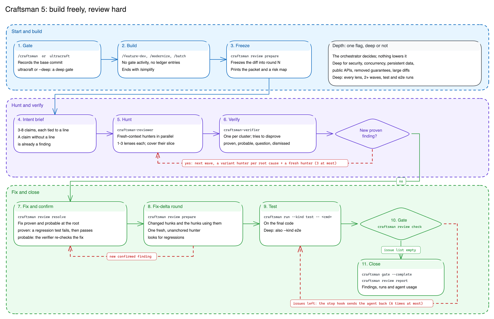
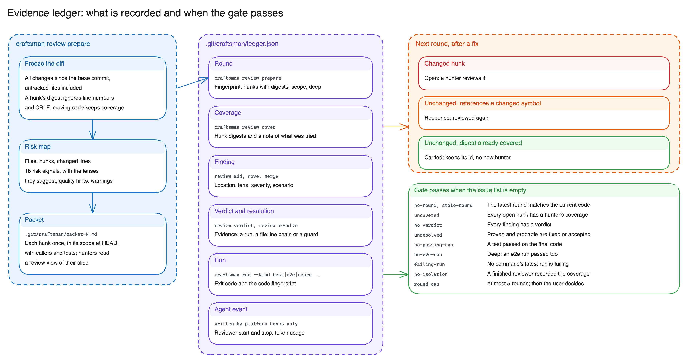

# How Craftsman Works

Craftsman is built on one idea: **build freely, review hard**. The agent implements without review
loops or ledger bookkeeping. When it finishes, the final diff is frozen and attacked by fresh-context
hunters; every finding is judged with evidence; the tests run on the final code. The gate checks
outcomes on that final diff, not the effort that led there.

This page is the one place that explains the protocol in full. The prompts it describes are the
source of truth: [`skills/craft-review/SKILL.md`](../skills/craft-review/SKILL.md) (the review) and
[`skills/craftsman/SKILL.md`](../skills/craftsman/SKILL.md) (the build around it). The README and the
[usage guide](usage.md) only summarize it.

---

## The Protocol

1. **Gate.** `craftsman gate --init [--deep] --task "<one line>"` records the base commit. The prompt
   hook runs it on platforms that have hooks.
2. **Build.** No ledger entries, no review. The agent asks you only when an ambiguity changes what
   gets built (`gate --await-user`, then `gate --resume`).
3. **Freeze.** `review prepare` computes the diff since the base into round N and prints the packet
   path and the **risk map**: files, hunks, changed lines, risk signals with the lenses they suggest,
   quality hints, and warnings such as a very large diff.
4. **Intent brief.** The orchestrator lists what the change must do, each claim tied to a line. A
   claim without a line is already a finding. It writes the brief from `git diff <base>` and the risk
   map, not from the full packet.
5. **Hunt plan and wave 1.** The orchestrator decides the hunters and launches them together, each
   as a fresh-context `craftsman-reviewer` subagent. Every review launches at least one, even for a
   one-line change, wherever the platform has subagents. Guidance, which the CLI does not enforce:
   - every code change gets `intent`, `contracts`, `failure`, `ripple`, `tests`, plus every lens
     the risk map suggests or the orchestrator's own reading calls for. Risk signals are pattern
     matches for a few languages: a floor, not a verdict. Deep assigns every lens;
   - `craft` and `design` go to a separate simplicity hunter so they never take attention from bug
     hunting. On Claude Code it runs on a cheaper model (`haiku`); bug hunters and the orchestrator
     never do;
   - 1-3 lenses per hunter, and large changes split by files (roughly 400 changed lines per hunter);
   - with two or more hunters, one also runs `sweep` over the whole diff;
   - a tiny change may get one hunter with all core lenses.
6. **Verify.** When findings exist, `craftsman-verifier` subagents run in parallel, one per cluster
   of related findings. They merge duplicates, try to disprove each finding, reproduce it where the
   code is runnable, and record a verdict. On Claude Code, a verifier whose cluster holds only
   `minor` or `nit` findings runs on the cheaper model (`haiku`); a cluster with any `blocker` or
   `major` finding gets the full model, and so does a verifier resumed to confirm a fix.
7. **Saturate.** If wave k produced a finding judged `proven` (reproduced), wave k+1 runs: one
   variant hunter per `proven` root cause plus one fresh hunter with a different partition or unused
   lenses, told nothing about earlier findings. The hunt stops at the first wave that adds nothing
   proven. Waves count as generations: a variant of a variant of a variant spawns nothing. That is
   at most 3 per round, and deep runs at least 2.
8. **Fix, confirm, re-check.** Three separate jobs.
   - *Fix.* Every `proven` or `probable` finding is fixed at the root cause, with a regression test
     where the project has tests.
   - *Is it fixed?* A `proven` finding is confirmed by its regression test: it fails before the fix
     and passes after, through `craftsman run`. A `probable` one (no repro) goes back to the verifier
     that judged it, resumed with only the fix diff, where the platform can resume an agent;
     otherwise a fresh verifier gets the finding and the diff. Then `review resolve --as fixed`, with
     a note that cites the run or the confirmation.
   - *Did the fix break anything?* `review prepare` opens a fix-delta round: the changed hunks plus
     the hunks that reference a changed symbol. One fresh, unanchored hunter checks it (never the
     finder or its verifier, who are anchored), with a verifier if it records findings. The round cap
     bounds this loop.
9. **Test.** `craftsman run --kind test -- <cmd>` on the final code; deep also `--kind e2e`.
10. **Close.** `craftsman review check`, then `craftsman gate --complete`, then `craftsman review
    report`.

A subagent that fails (rate limit, timeout) is retried once with a smaller slice. If subagents keep
failing, the agent runs `gate --await-user` and tells you what is not covered; in review-only mode
the report is `--partial`.

Accepting a finding instead of fixing it is a protocol rule, not something the CLI checks beyond
refusing blockers: a `major` is accepted only after the user agreed.

### `/craft-review`

The same hunt (steps 3-7) against a base, with a frozen scope, and no fixes unless asked. It ends
with `review check --review-only` and `review report --review-only`. Fixing adds steps 8-9.
`ultracraft` inside `/craft-review` makes it a deep review. It never opens a gate: only `/craftsman`
does.

### Adaptive depth

There is one depth, `deep`, and the orchestrator decides when to use it. The canonical list of what
calls for it (security-relevant code, concurrency, persistent data, public APIs, removed guarantees,
large diffs, a user who asks for care) is under **Depth** in the
[`craft-review` skill](../skills/craft-review/SKILL.md). Deep suggests every lens, expects at least
two waves, and makes the gate require both a test run and an e2e run. `review prepare --deep`
escalates; `prepare` may print a hint such as `Depth: deep suggested (signals: auth H3, concurrency
H7)`. Inside a gate session, `--deep` raises the gate for good. Depth never goes down.

---

## What Hunters Read

A review costs agents times turns times context, so the inputs are kept small.

- **Packet.** Each hunk appears once, inside its enclosing scope at HEAD, with `+` and `-` marks on
  the changed lines and `[H3]` markers around each hunk, plus callers, tests and the hunk's risk
  signals. It has no lens table or recording cheat sheet (the risk map and the hunter's agent
  definition already carry them), so a small diff costs a hunter little more than its code context.
  A `review view` is the same layout for some of the hunks.
- **Scout.** `craftsman review scout <H#|path:line|symbol>` answers with code, deterministically and
  without a model: the base version of the enclosing scope, callers, and tests, capped at 12,000
  characters. Hunters ask the scout before opening whole files.
- **Briefs.** Every hunter and verifier prompt starts with the same shared block (intent brief, base
  ref, rules), then its slice, then its lenses. Identical prefixes are served from the prompt cache.
  A variant hunter gets a mini-slice: the root cause, its location, and `review view --hunks` of the
  affected hunks.
- **Pipelining.** Where agents run in the background (Claude Code, Antigravity async subagents), a
  hunter's verifier starts when that hunter finishes, a variant hunter starts when a finding is judged
  `proven`, and the fresh hunter starts at the first `proven` verdict (with wave 1 when deep, which
  needs a second wave anyway). Where parallel subagents are a
  barrier (Copilot), the waves stay as they are.
- **Remaining work.** `craftsman review show --hunks` lists the hunks still to cover.
  `review show` also prints each finding's scenario and verdict evidence, so a verifier needs no
  `--json` call.
- **Inbox fallback.** If a heredoc needs approval, the agent writes the JSON to the path that
  `craftsman review inbox <add|cover>` prints and passes `--from-json <path>`.
- **Usage.** Where the platform hands over the subagent transcript, `review report` and
  `craftsman status` total tokens and agent time per role (hunters, verifiers).

---

## Evidence Ledger

Everything goes into `.git/craftsman/ledger.json`, stored separately for each worktree and outside
commits (schema 3).

| Record | Written by | Gate requirement |
| :--- | :--- | :--- |
| **Round**: diff fingerprint, hunks with digests, scope, `deep` flag | `review prepare` | The latest round matches the current code |
| **Coverage**: hunk digests and a one-line note (at least 20 characters) on what a hunter examined and tried | `review cover` (or `--from-json`) | Every hunk of the round is covered, in this round or an earlier one |
| **Finding**: location, lens, severity, scenario | `review add` (or `--from-json`); `review move` fixes a line; `review merge` merges duplicates with a shared root cause | Every finding has a verdict |
| **Verdict**: `proven` (reproduction `--run R#`), `probable` (`static: <file:line chain>` or `no-repro: <why>; <chain>`), `question` (`intent: <source>; <file:line>`, non-blocking findings only), `dismissed` (run or `file:line`) | `review verdict` (or `--from-json`) | `proven` and `probable` findings are resolved. In review-only mode they go into the report as warnings |
| **Resolution**: `fixed` (only after a code change) or `accepted` (never for blockers) | `review resolve` | All blocking findings are resolved |
| **Run**: argv, working directory, exit code, output tail, diff fingerprint | `craftsman run` | A passing test run (and an e2e run when deep) on the final code that did not modify files. The last run of every command succeeds unless retired with `review waive-run` and a visible reason |
| **Agent event**: reviewer subagent start and stop, with token usage when known | platform hooks | An independent reviewer finished after the round was prepared |

Every record is tied to a diff fingerprint, so a code change invalidates old evidence. Details that
matter when reading the ledger:

- **Hunk ids are stable and never reused.** A carried hunk keeps its id, so ids can be sparse (`H1`,
  `H4`, `H9`). Do not assume `H1..Hn`; `review show --hunks` lists what is left.
- **A hunk stays covered across rounds by its digest**, which ignores line numbers and CRLF, so the
  next round re-reviews only changed hunks and hunks that reference a changed symbol. `cover` skips
  carried hunks.
- **`cover --files` is forgiving.** It accepts `./x`, backslashes, absolute paths inside the
  repository, and the old path of a renamed file.
- Generated files (`__pycache__`, build caches, `node_modules`, ...) are skipped; custom patterns go
  in `.craftsmanignore`.

---

## What the Gate Checks and What It Does Not

The gate reports an issue list. It passes when the list is empty:

| Issue | Meaning |
| :--- | :--- |
| `no-round`, `stale-round` | No review round, or the code changed since the last one |
| `uncovered` | Open hunks no hunter has covered |
| `no-verdict` | A finding has no verdict |
| `unresolved` | A `proven` or `probable` finding is neither fixed nor accepted |
| `no-passing-run` | No passing test run on the final code |
| `no-e2e-run` | Deep only: no passing e2e run. A deep gate needs both a test run and an e2e run |
| `failing-run` | The latest run of a command failed and was not waived |
| `no-isolation` | The platform gives isolation evidence, but no `craftsman-reviewer` finished after this round was prepared, or a hunk was covered outside any reviewer run |
| `round-cap` | More than 5 distinct diffs were reviewed: the agent stops and the user decides |

- **Isolation is checked per round.** Coverage must come from a `craftsman-reviewer`: every hunk a round's
  coverage holds needs a finished reviewer behind at least one of its records. Claude Code hands over the
  reviewer's own transcript, so the records it printed (`Coverage recorded (C3)`) are credited to it, provided they were made inside its run; where
  the platform gives no transcript, or the transcript shows a token that no recognized recording call printed,
  a record counts when it was made while a reviewer ran. A stop whose agent id matches no start is paired
  first-in, first-out with the unpaired starts of its agent name. The latest round
  with non-carried hunks also needs a reviewer that finished and recorded something while it was current.
  A round replaced before anything was covered in it needs none. Findings may come from anyone (the
  orchestrator records intent findings itself; verifiers judge every one). A reviewer must record coverage
  or a finding before it stops; the hook sends one that did not back to work, once.
- **No isolation evidence, no claim.** When the platform gives none, the gate still closes, and the
  report carries the `SELF-REVIEWED` banner, whether the review was deep or not.
- **What it does not assess.** Business-requirement fit, naming quality, and architecture outside the
  files touched by the diff. Every report lists these under `Not assessed by the gate`. The gate also
  does not judge how hard the hunters looked: it checks that fresh hunters covered every hunk of the
  frozen diff and that every finding has checkable evidence. A very large diff produces a warning in
  `prepare` and in the report; it does not hand off to the user.

### Upgrading from Craftsman 4.x

Nothing to run. The first command that reads a pre-5.0 gate state or a schema 2 ledger archives it
(`craftsman_state.json.v4.bak`, `ledger.v2.bak.json`) and starts fresh, so neither `gate --init
--takeover` nor `review reset` is needed. Re-run `craftsman install` to refresh the skills and agents.

---

## Review Lenses

A lens is a focused review angle with specific probes. `review prepare` suggests lenses from the
risk signals in the diff; the orchestrator assigns them to hunters. The catalog is
[`craftsman/lenses.py`](../craftsman/lenses.py), the probes are in
[`skills/craft-review/lenses.md`](../skills/craft-review/lenses.md), and a hunter prints only its own
with `craftsman skill show craft-review --lenses <ids>`.

| Lens | What it looks for | Suggested |
| :--- | :--- | :--- |
| `intent` | Whether the change does all it claims, everywhere it should, and nothing else | Every code change (core) |
| `contracts` | Whether each changed function handles the full range of inputs it can receive | Every code change (core) |
| `failure` | Whether failures are loud, precise, and clean | Every code change (core); also on `errors`, `process`, `filesystem`, `network`, `sql` signals |
| `ripple` | Callers, configs, and users of what changed or disappeared | Every code change (core); also on `deletion`, `config` signals |
| `tests` | Whether the tests would fail if the changed behavior broke | Every code change (core) |
| `state` | Shared state, resource release, repeated runs, concurrency | `concurrency`, `filesystem`, `time` signals |
| `trust` | Untrusted input reaching a dangerous sink, bypassed permission checks | `process`, `sql`, `deserialization`, `auth`, `network`, `regex`, `filesystem` signals |
| `platform` | Operating systems, shells, encodings, locales, time zones | `platform`, `time`, `process`, `filesystem` signals |
| `model` | Illegal states the data model allows, invariants | `datamodel` signal |
| `craft` | Reuse, needless complexity, misleading names and comments | Every code change (simplicity hunter) |
| `design` | Overall design and size of the change, what can be deleted | Every code change (simplicity hunter) |
| `sweep` | Hunks that are each correct but disagree with each other, the docs, or the config | Every code change (whole-diff lens; one hunter runs it when two or more hunt) |

Docs-only changes get `intent` and `craft`. A deep round suggests every lens.

---

## Platform Enforcement

The protocol, lenses, subagents, and ledger are shared across platforms. What differs is the
mechanism that blocks completion.

| Platform | Stop gate | Reviewer isolation | Subagents |
| :--- | :--- | :--- | :--- |
| GitHub Copilot in VS Code | `Stop` hook blocks until `review check` passes | `SubagentStart`/`SubagentStop` hooks | `craftsman-reviewer`, `craftsman-verifier` agents |
| GitHub Copilot CLI | `agentStop` hook | `subagentStart`/`subagentStop` hooks | The same agents |
| Claude Code | `Stop` hook | `SubagentStart`/`SubagentStop` hooks | The same agents in `~/.claude/agents` |
| Google Antigravity | `Stop` hook | Finished `craftsman-reviewer` subagents are recorded from the transcript when the turn ends | `invoke_subagent` (`TypeName: self`, `Role: craftsman-reviewer`) |
| Codex, Cursor, and others | `craftsman gate --complete` refuses completion until the ledger passes validation | None | None |

The gate runs only in a `/craftsman` session; outside it, the hooks do nothing. After six forced
continuations in a row without fewer open issues (`MAX_CONTINUATIONS`), the stop hook lets the agent
through and tells the user the gate was not satisfied. When a hook fails, the agent continues with a
warning that the gate was not checked; a failing `pre-tool` check asks the user to confirm the tool
call instead (Copilot denies it). Install, hook, and guard internals:
[harness-architecture.md](harness-architecture.md) and [guards.md](guards.md).
